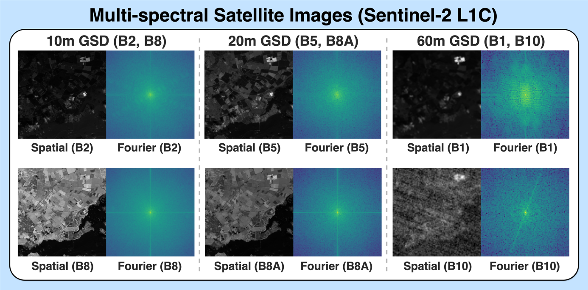
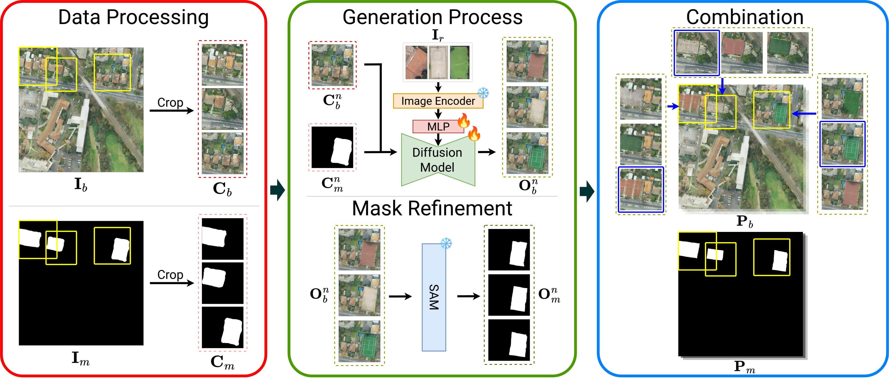

# Hi 👋, welcome!

I am an AI researcher and engineer. 

My current main interest is in building agentic LLM systems, including RAG, MCP, harness engineering, and the LLM training itself.

I also have expertise in the following domains: semantic segmentation, few-shot learning, implicit neural representation, neural compression, 3D computer graphics.

🚀 I'm always excited to collaborate on innovative projects! Feel free to reach out to me at my email.

# Awards
- 1st Winner of ["AI4EO Map Your City Challenge"](https://ai4eo.eu/portfolio/mapyourcity-challenge/) (2024)
- 4th Winner of ["OpenEarthMap Land Cover Mapping Few-Shot Challenge"](https://cliffbb.github.io/OEM-Fewshot-Challenge/) (2024)

# Selected Publications

<table class="tab-pub">
  <tbody>
    <tr>
      <td></td>
      <td>
        <a href="https://arxiv.org/abs/2506.01234">Fourier-Modulated Implicit Neural Representation for Multispectral Satellite Image Compression</a> 
        Woojin Cho*, <b>Steve Andreas Immanuel*</b>, Junhyuk Heo, and Darongsae Kwon 
        
*Equal contribution

        <a href="https://www.2025.ieeeigarss.org/">IEEE International Geoscience and Remote Sensing Symposium</a> <b style="color: #cf2e1f">(Oral)</b>, 2025 
      </td>
    </tr>
    <tr>
      <td></td>
      <td>
        <a href="https://steveimm.id/rs-paint/">Tackling Few-Shot Segmentation in Remote Sensing via Inpainting Diffusion Model</a> 
        <b>Steve Andreas Immanuel</b>, Woojin Cho, Junhyuk Heo, and Darongsae Kwon 
        <a href="https://ml-for-rs.github.io/iclr2025/">ICLR Machine Learning for Remote Sensing Workshop</a> <b style="color: #cf2e1f">(Best Paper Award)</b>, 2025
      </td>
    </tr>
    <tr>
      <td></td>
      <td>
        <a href="https://steveimm.id/implisat/">Neural Compression for Multispectral Satellite Images</a> 
        Woojin Cho*, <b>Steve Andreas Immanuel*</b>, Junhyuk Heo, and Darongsae Kwon 
        
*Equal contribution

        <a href="https://neuralcompression.github.io/workshop24">NeurIPS Neural Compression Workshop</a>, 2024
      </td>
    </tr>
    <tr>
      <td></td>
      <td>
        <a href="https://openaccess.thecvf.com/content/CVPR2024W/L3D-IVU/papers/Immanuel_Learnable_Prompt_for_Few-Shot_Semantic_Segmentation_in_Remote_Sensing_Domain_CVPRW_2024_paper.pdf">Learnable Prompt for Few-Shot Semantic Segmentation in Remote Sensing Domain</a> 
        <b>Steve Andreas Immanuel</b> and Hagai Raja Sinullinga 
        <a href="https://sites.google.com/view/l3divu2024/overview">CVPR Learning with Limited Data Workshop</a>, 2024
      </td>
    </tr>
    <tr>
      <td></td>
      <td>
        <a href="https://www.sciencedirect.com/science/article/abs/pii/S0950705123005233">Lightweight Recurrent Cross-modal Encoder for Video Question Answering</a> 
        <b>Steve Andreas Immanuel</b> and Cheol Jeong 
        <a href="https://www.sciencedirect.com/journal/knowledge-based-systems">Knowledge-Based System</a>, 2023
      </td>
    </tr>
    <tr>
      <td></td>
      <td>
        <a href="https://www.sciencedirect.com/science/article/abs/pii/S0262885623001026">Improving distinctiveness in video captioning with text-video similarity</a> 
        Vania Velda, <b>Steve Andreas Immanuel</b>, Willy Fitra Hendria, and Cheol Jeong 
        <a href="https://www.sciencedirect.com/journal/image-and-vision-computing">Image and Vision Computing</a>, 2023
      </td>
    </tr>
  </tbody>
</table>

# Misc
## Peer Review
- IEEE Transactions on Geoscience and Remote Sensing
- Knowledge-Based Systems
- Image and Vision Computing
- ICLR 2026 - [Machine Learning for Remote Sensing Workshop](https://ml-for-rs.github.io/iclr2026/)
- CVPR 2026 - [Efficient and On-Device Generation Workshop](https://cvpr26-edge.github.io/)

## [ESA-NASA International Workshop on AI Foundation Model for EO](https://nikal.eventsair.com/cmspreview/nasa-esa-international-workshop-on-geospatial-ai-foundation-model-for-earth-observation-and-earth-sciences/)
1-page abstract paper (co-author):
- [Multi-Modal Foundation Model for Electro-Optical and SAR Images using Neural Operator-Based CLIP](/assets/images/esa-nasa/1.jpeg)
- [A Unified Framework for Multi-Resolution and Multi-Spectral Satellite Imagery in Foundation Model Training](/assets/images/esa-nasa/3.jpeg)
- [Leveraging Few-Shot Learning and Data Augmentation for Scrap Metal Segmentation in Satellite Imagery](/assets/images/esa-nasa/4.jpeg)
- [Neural Representation-Based Foundation Model for Satellite Images Pansharpening](/assets/images/esa-nasa/5.jpeg)
- [Continual Pretraining for Satellite Imagery: A Foundation Model Framework with LLM Agents](/assets/images/esa-nasa/2.jpeg)