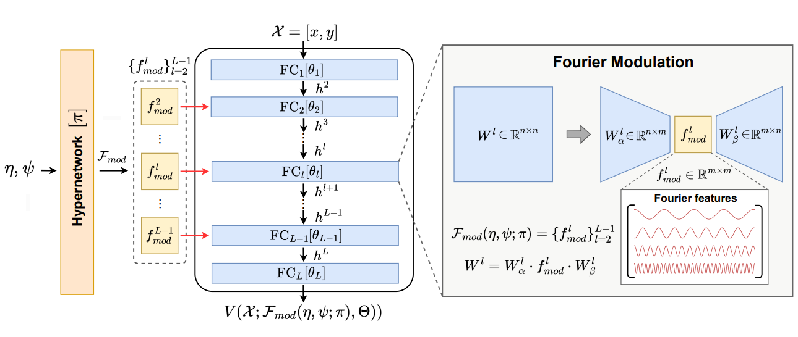
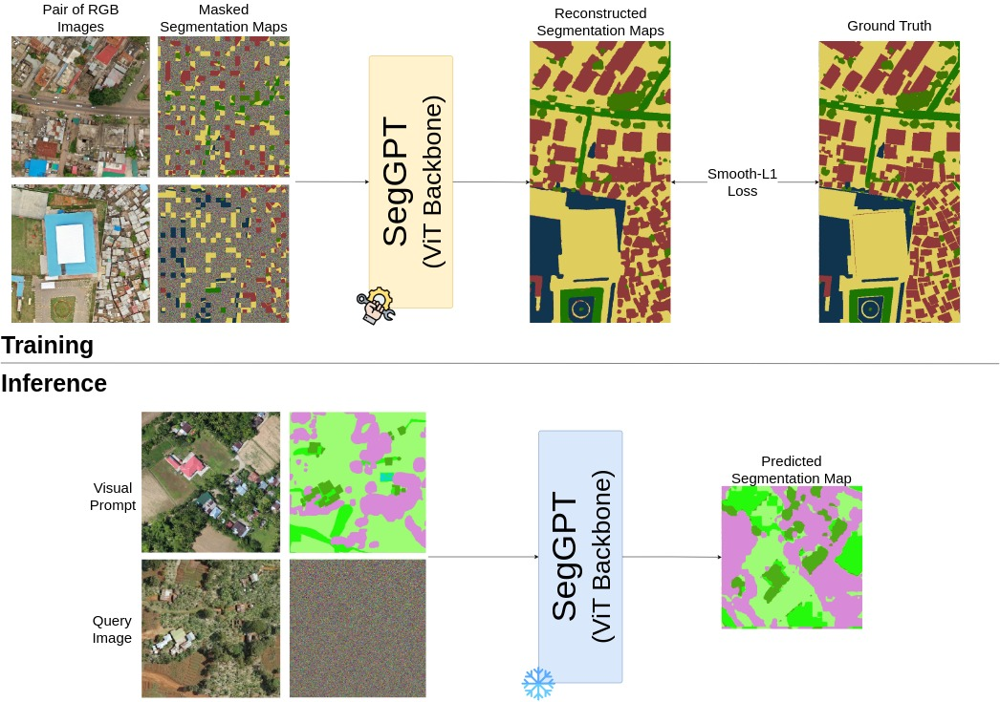
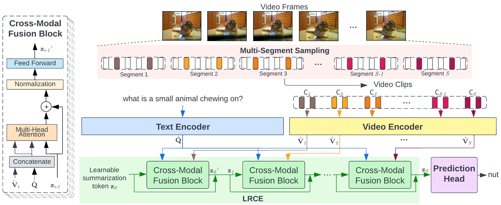
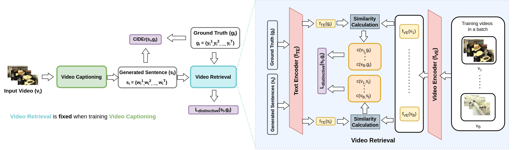

# Hi 👋, welcome!

I am an AI researcher. My main topics of interest are computer vision, implicit neural representation, neural compression, and 3D computer graphics.

🚀 I'm always excited to collaborate on innovative projects! Feel free to reach out to me at my email.

# Awards
- 1st Winner of ["AI4EO Map Your City Challenge"](https://ai4eo.eu/portfolio/mapyourcity-challenge/) (2024)
- 4th Winner of ["OpenEarthMap Land Cover Mapping Few-Shot Challenge"](https://cliffbb.github.io/OEM-Fewshot-Challenge/) (2024)

# Publications

<table class="tab-pub">
  <tbody>
    <tr>
      <td></td>
      <td>
        <a href="https://steveimmanuel.github.io/implisat/">Neural Compression for Multispectral Satellite Images</a> 
        Woojin Cho*, <b>Steve Andreas Immanuel*</b>, Junhyuk Heo, and Darongsae Kwon 
        
*Equal contribution

        <a href="https://neuralcompression.github.io/workshop24">NeurIPS Neural Compression Workshop</a>, 2024
      </td>
    </tr>
    <tr>
      <td></td>
      <td>
        <a href="https://openaccess.thecvf.com/content/CVPR2024W/L3D-IVU/papers/Immanuel_Learnable_Prompt_for_Few-Shot_Semantic_Segmentation_in_Remote_Sensing_Domain_CVPRW_2024_paper.pdf">Learnable Prompt for Few-Shot Semantic Segmentation in Remote Sensing Domain</a> 
        <b>Steve Andreas Immanuel</b> and Hagai Raja Sinullinga 
        <a href="https://sites.google.com/view/l3divu2024/overview">CVPR Learning with Limited Data Workshop</a>, 2024
      </td>
    </tr>
    <tr>
      <td></td>
      <td>
        <a href="https://www.sciencedirect.com/science/article/abs/pii/S0950705123005233">Lightweight Recurrent Cross-modal Encoder for Video Question Answering</a> 
        <b>Steve Andreas Immanuel</b> and Cheol Jeong 
        <a href="https://www.sciencedirect.com/journal/knowledge-based-systems">Knowledge-Based System</a>, 2023
      </td>
    </tr>
    <tr>
      <td></td>
      <td>
        <a href="https://www.sciencedirect.com/science/article/abs/pii/S0262885623001026">Improving distinctiveness in video captioning with text-video similarity</a> 
        Vania Velda, <b>Steve Andreas Immanuel</b>, Willy Fitra Hendria, and Cheol Jeong 
        <a href="https://www.sciencedirect.com/journal/image-and-vision-computing">Image and Vision Computing</a>, 2023
      </td>
    </tr>
  </tbody>
</table>
