Have you seen snow trail effect in games like Red Dead Redemption 2? It looks like a very complex thing to do because you can see the snow deforms as the player passes by. While it is definitely not on the same level, we could replicate it fairly easily using shader by modifying the vertex position of the mesh that we render.

<div style="text-align:center">
  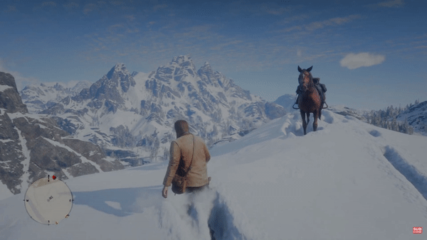
</div>
<br>

But wait, the snow **interacts** with player movement! That's the neat part, we are going to utilize a dynamic texture to tell our shader the track of the player. In Unity, we can use **render texture** to achieve this. This texture will store player's track movement at runtime.

In this tutorial, we are going to attempt to replicate snow trail effect using shader. With this shader, you can make a simple plain become an interactive terrain covered in snow that interacts with other objects. This GIF below shows the final result.

<div style="text-align:center">
  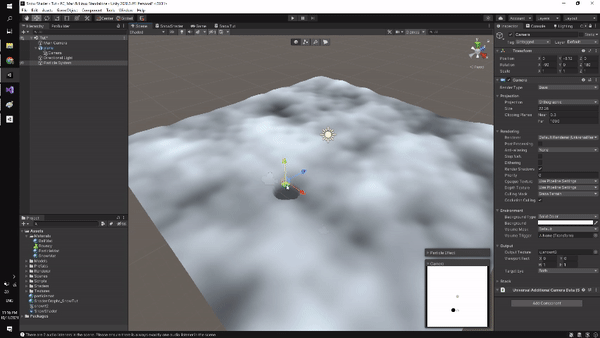
</div>
<br>


For this tutorial, we are going to need a plane mesh that has a lot of vertices. The default plane object from Unity is not going to suffice for this purpose, so I created a new one in Blender and subdivided until it has enough vertices. You can do that yourself or download that from [here](https://github.com/steveimm/unity-snow-shader/blob/master/Assets/Models/plane.fbx).
 The full source code for this project is available at [SteveImmanuel/unity-snow-shader](https://github.com/steveimm/unity-snow-shader.git).

Before we start, this tutorial assumes you have the following requirements:
- Basic understanding of Unity
- Basic understanding of Shader
- Basic knowledge of linear algebra

## Project Setup
Let's create a new Unity project. We are going to use Universal Render Pipeline (URP) for this project, so you can choose the URP template or use the 3D template and then upgrade it later on once you are inside Unity.

<div style="text-align:center">
  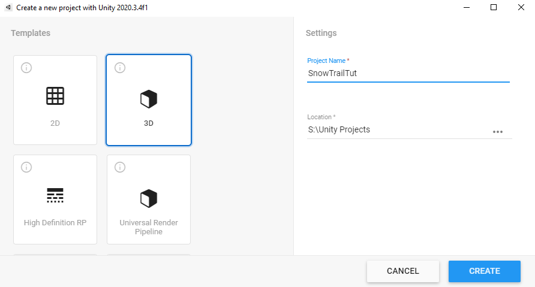
</div>
<br>

Next, we need to download the Shader Graph package from the Package Manager (```Window```->```Package Manager```). If you can't find it, make sure to choose the Unity Registry from the drop down menu. 

<div style="text-align:center">
  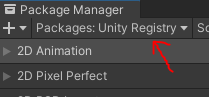
</div>

Make sure these two packages are installed.

<div style="text-align:center">
  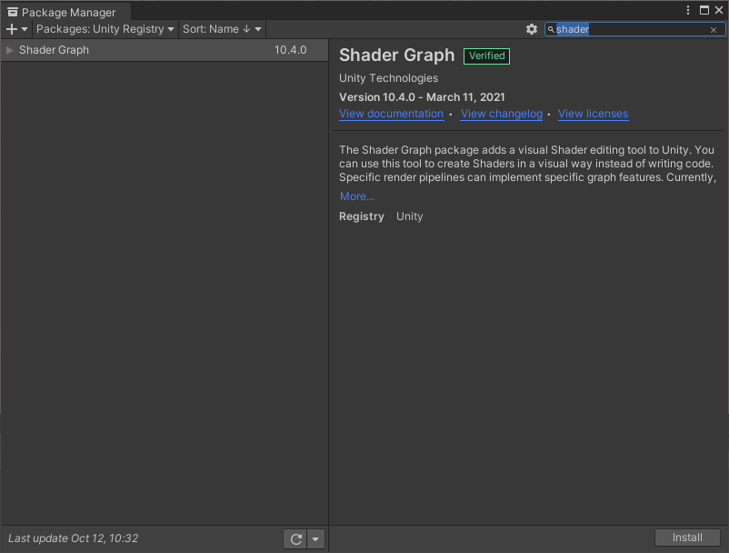
  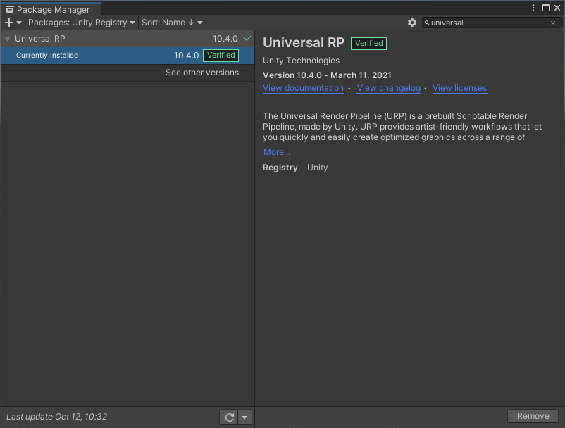 
</div>
<br>

## Scene Setup

Now, let's import the plane into Unity. Place the `fbx` or `blend` file to the asset folder of the Unity project. We need to change the import setting a little. Select the imported model and in the inspector, **untick** the `Convert Units` option.

<div style="text-align:center">
  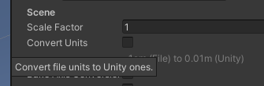
</div>
<br>

Place the plane into your scene and you will get a very big plane blocking your whole scene. Simply reset the transform and you are good to go.

<div style="text-align:center">
  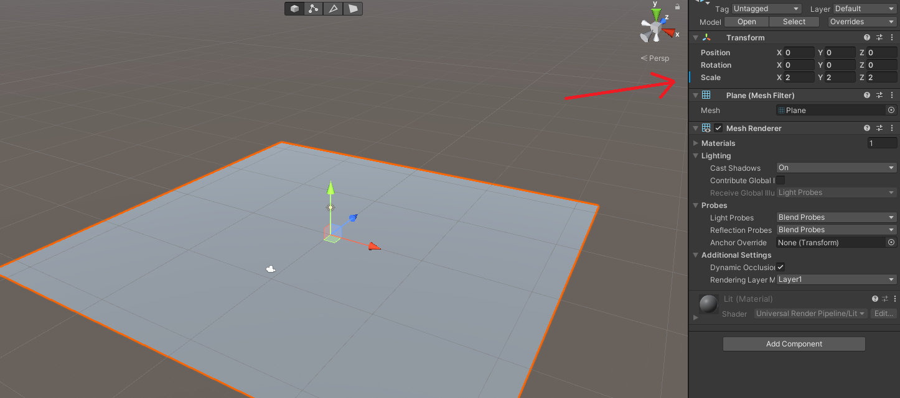
</div>
<br>

If you encounter a problem where you have a **pink-colored object**, I recommend you check [my other tutorial](/posts/liquid-wobble/#scene-setup) on the `Scene Setup` section to address this issue.
{: .notice--info}

## Snow Trail Shader
Create a `Lit Shader Graph` from the URP as shown in the picture below. Let's name it `SnowShader`. 

<div style="text-align:center">
  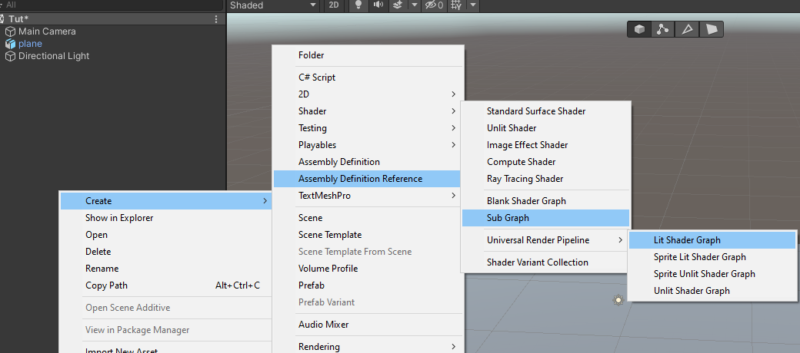
</div>
<br>

Then, create a new material from that shader and name it `SnowMat`. Assign the material to the plane.

<div style="text-align:center">
  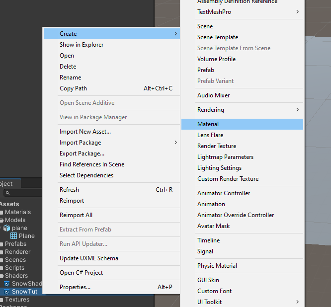
</div>
<br>

In this shader, the main focus is in the `Vertex` part, especially the `Position` output. That output lets us control where each vertices of the object will be rendered in the screen. We are going to manipulate the positions based on render texture to get the trail effect.

<div style="text-align:center">
  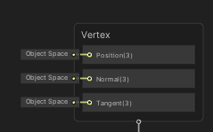
</div>
<br>

In the `Main Preview` window (located on the bottom right corner of the shader graph editor), you can use custom mesh and select the plane mesh in order to better visualize and quickly see the result without having to save the shader.

<div style="text-align:center">
  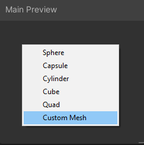
</div>
<br>

This shader consists of 2 main modules which are snow texture and vertex displacement. But, in order for this shader to work properly we also need to setup a render texture.

**Note**: If you're having a hard time understanding what a node does, you can always refer to the [Official Documentation](https://docs.unity3d.com/Packages/com.unity.shadergraph@6.9/manual/Node-Library.html).
{: .notice--info}


### Snow Texture
As you can see, our plane right now just have a plain color and doesn't look like a snow. We can paint this plane with a texture to make it look more like a snow terrain. To achieve this we are going to use simple noise.

Create three `float` property and name it `NoiseScale`, `NoiseStrength` and, `NoisePower`. Next, add `Simple Noise` node and connect the `NoiseScale` to the `Scale` input. Connect the output of the node to `Power` node and use the `NoisePower` to control the `B` input. Lastly, multiply the output of the `Power` with `NoiseStrength`.

<div style="text-align:center">
  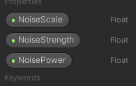
  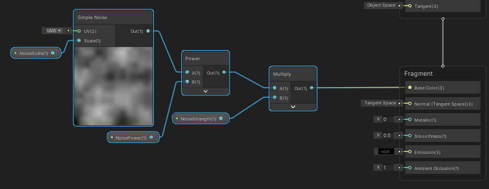
</div>
<br>

Basically, `NoiseScale` controls how rough our snow terrain, `NoisePower` controls the overall height of the snow pile, while `NoiseStrength` controls the maximum height of the snow pile.

### Vertex Displacement
Currently our snow terrain still looks flat. We can use the noise that we made earlier as some kind of `height map` to control the `y` position of each vertex in the plane mesh.

<div style="text-align:center">
  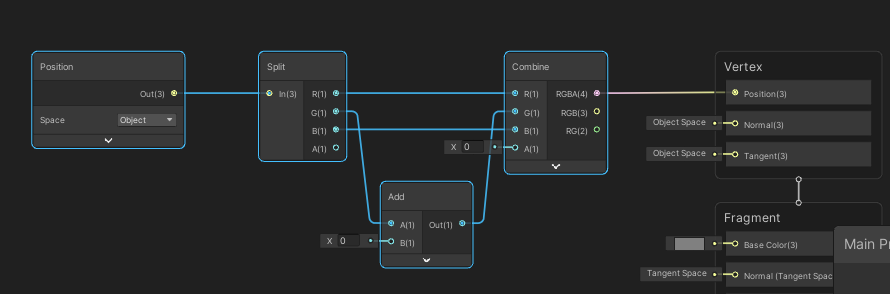
</div>
<br>

First, create `Position` node and set it to `Object Space`, then use `Split` node to get the position information for each axis. Use the `Add` node for the `G` output (which represents y axis) from the `Split` node to add some value. We will control this value, for now let's leave it as default. Now, combine everything back using `Combine` node and connect the output to the `Position` input of `Vertex`.

<div style="text-align:center">
  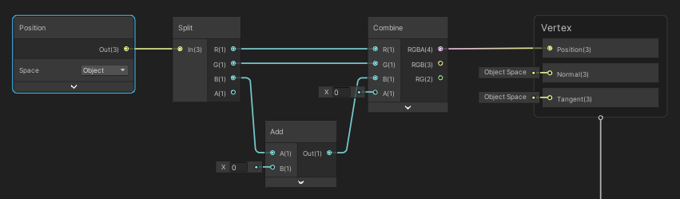
</div>
<br>

Next, let's get the noise output from the series of nodes that we made earlier. Connect the noise output to the `Add` node.

<div style="text-align:center">
  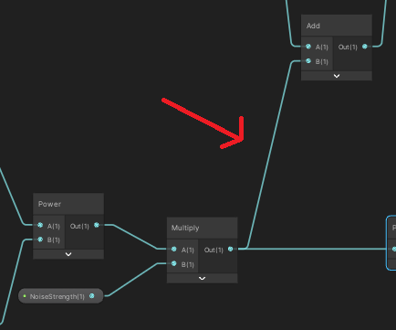
</div>
<br>

**Note**: There is a bug in shader editor in Unity where it won't allow you to connect some nodes even though they are compatible. To workaround this issue, you can connect the output first to a `Preview` node, then connect the output of the `Preview` node to the desired node.
{: .notice--info}

Save the shader, go back to the `Scene` and fiddle around with the material property. You should get a pretty good snow terrain depending on the material property values.

<div style="text-align:center">
  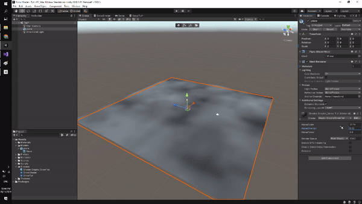
</div>
<br>

### Creating Render Texture
To create the trail effect, we need to deform the snow based on another object position. We can use render texture to record the object movement and feed it to our shader.

In order to create render texture, we need to set up second camera. This camera is **special**, unlike our main camera that renders to the game, it will render the output to the render texture.

First, create new render texture from the project hierarchy and name it `SnowRT`.

<div style="text-align:center">
  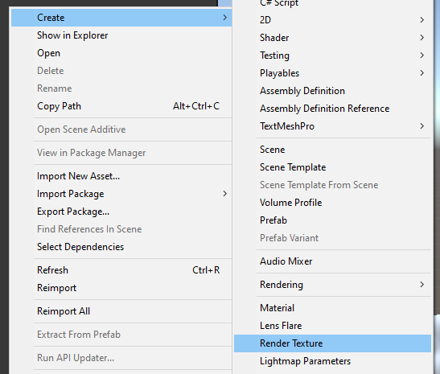
</div>
<br>

Create new camera and parent it to the existing plane. We want this camera to render **only** our plane without perspective, so change the projection type to `Orthographic`.

Remove the `Audio Listener` component from this camera because there can be only one of this component in a scene and it should be placed in the main camera.

<div style="text-align:center">
  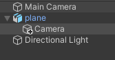
  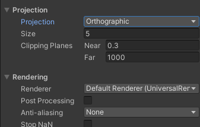
  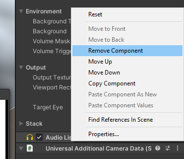
</div>
<br>

Configure the `Output` of the camera to render into the render texture that we created earlier. Change the `Background Type` to `Solid Color` and set it to **complete** white. This will be important later on.

<div style="text-align:center">
  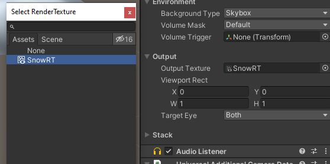
  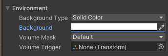
</div>
<br>

Change the size of the projection in order for the camera to cover the whole plane. You can see the output of the camera in the preview.

<div style="text-align:center">
  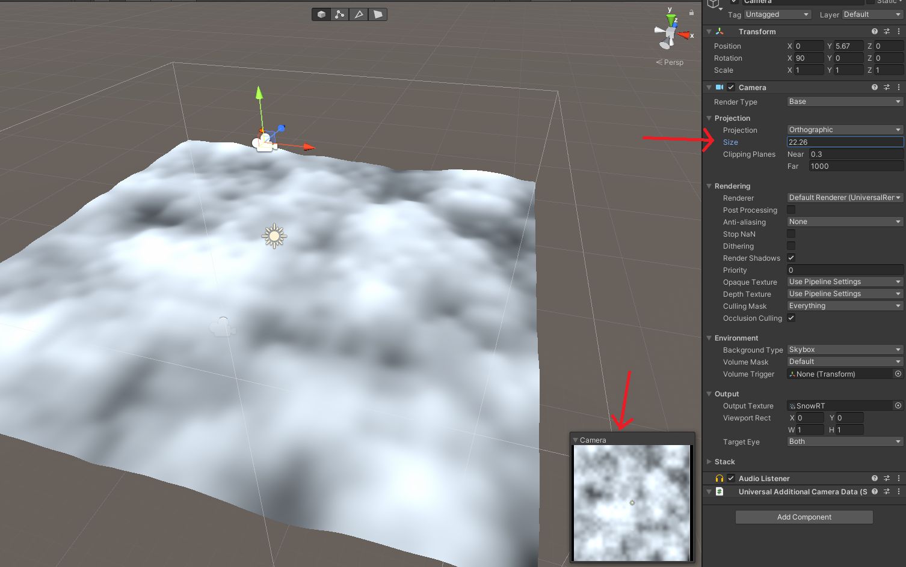
</div>
<br>

Now, if everything is correct, you should see that this camera only outputs **white color**. We need to paint into this texture to indicate the position of an object. To do that, we are going to use `Particle System`.

Create new `Particle System` in the project hierarchy.

<div style="text-align:center">
  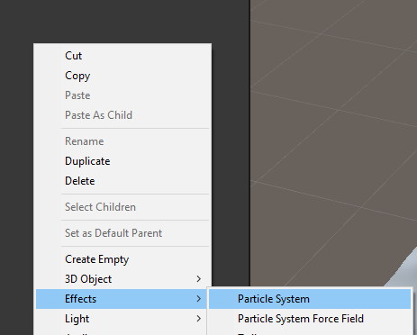
</div>
<br>

Next, let's create a custom material for the `Particle System` and name it `ParticleMat`. In the shader dropdown menu, choose `Particles Unlit Shader` from the URP group. Change the `Color Mode` to multiply, use default particle as the `BaseMap` and set the color to black.

<div style="text-align:center">
  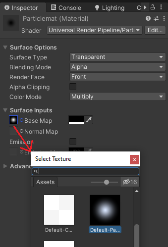
</div>
<br>

Remember that before, we set our camera output color to complete white. Now, we are going to pain using this black color. This is the reason why we need to set the `Color Mode` to multiply, because 0 (white) multiplied by 1 (black) will be 0 (black). To gain deeper understanding about this, I suggest you read from [this documentation](https://docs.unity3d.com/Manual/shader-StandardParticleShaders.html).

**Note**: The color black corresponds to RGB value of (0, 0, 0), while white is (1, 1, 1).
{: .notice--info}

Let's configure the `Particle System`. We want a constant spawning particle from a single location. To do that, change the `Shape` to sphere and `Radius` to near 0. Next, change the `Simulation Space` to `World` because we want this particle to move around. Assign the `ParticleMat` to the `Material` property and change the remaining parameters value according to the image below.

<div style="text-align:center">
  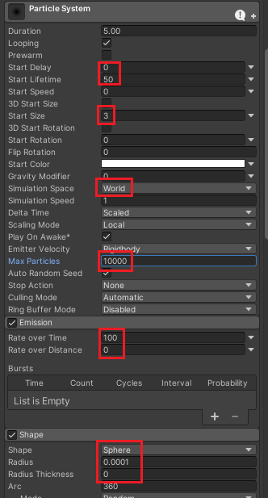
  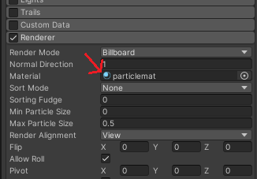
</div>
<br>

We want our second camera to basically only render this `Particle System`. To do that, create a new `Layer` and name it `SnowTerrain`. Place the `Particle System` in this layer by setting it in the inspector. Then, set our second camera `Culling Mask` to only select `SnowTerrain`.

<div style="text-align:center">
  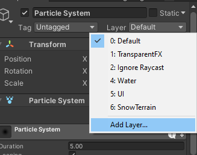
  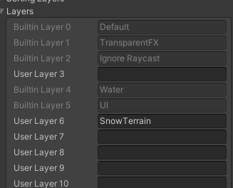
</div>
<br>

<div style="text-align:center">
  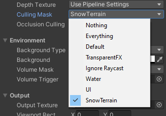
</div>
<br>


Try to move around the particle in the `Scene`. You should get the following result. Notice in the camera preview, the camera renders the movement that you do with the `Particle System` in black while the rest is white.

<div style="text-align:center">
  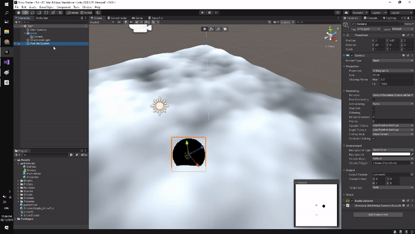
</div>
<br>

**Tips**: To view the camera preview while moving the `Particle System`, you can select the camera then **lock** the inspector first (located in top right corner).
{: .notice--info}

### Integrating Render Texture with Shader
Notice that our render texture is actually only has grayscale value, so basically it goes from 0 to 1. We are going to use this texture as a **mask** for our vertex displacement. In places where the color is black (value of 0) we want no vertex displacement, while in places where the color is white (value of 1) we want vertex displacement based on the noise. This is the **core logic** of this shader.

Back in the shader graph editor, create new `Texture2D` property and name it `SnowRT`. Sample it using `Sample Texture 2D LOD` node. Multiply the output with the noise earlier and connect the output to the `Add` node.

<div style="text-align:center">
  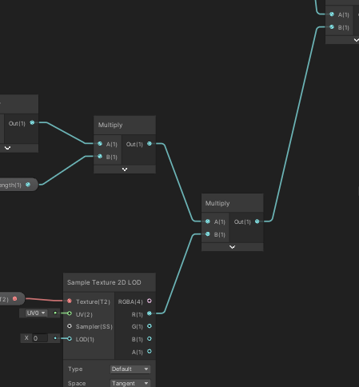
</div>
<br>

**Note**: We need to use `Sample Texture 2D LOD` node because we are using it to modify vertex position. This happens in the **vertex stage** of the shader in which the GPU doesn't have enough information to auto-compute the LOD so we need to supply it manually.
{: .notice--info}

Lastly, let's take care of the color. Create 2 new `Color` property, name it `SnowColor` and `TrailColor`. Get the output of `Sample Texture 2D LOD` node in any channel (doesn't matter which because the color is only black and white so the value is the **same** in all channel) and connect it to `One Minus` node. We will get the reverse of our render texture value in which now white will represent the object trail while the rest is black. 
Multiply it with `TrailColor` and add the output to the noise. Then finally multiply the last output with `SnowColor` and connect it `Base Color`. 

<div style="text-align:center">
  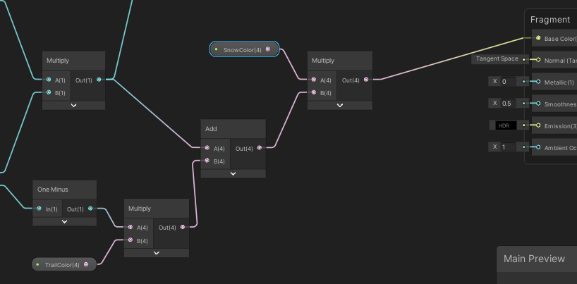
</div>
<br>

One last small things, create two new `float` property and name it `Smoothness` and `Metallic` and connect it directly to the `Fragment` node.

<div style="text-align:center">
  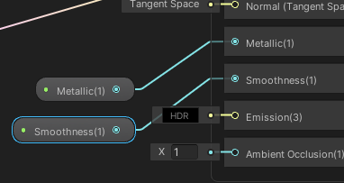
</div>
<br>

Save the shader, go back to the `Scene` and move around the `Particle System`. 

You might encounter the issue where the movement does not match or rather mirrored. To fix it you can simply **re-orient** your second camera in a way until it the result matches your movement. Another issue might be the shadow in the terrain which can be resolved simply by **disabling the cast shadow** in the inspector.

<div style="text-align:center">
  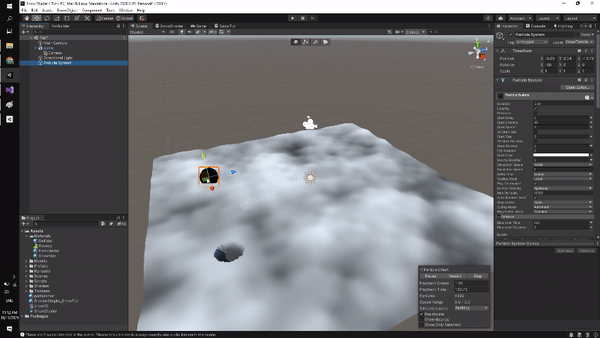
</div>
<br>

**Tips**: You can hide the `Particle System` while remaining active by pressing the eye icon in the object hierarchy as shown in the GIF above.
{: .notice--info}

After correcting the camera orientation, disable cast shadow, you should get something like this.

<div style="text-align:center">
  
</div>
<br>

## What's Next
You can integrate this effect with maybe a player in your game by placing the `Particle System` as the child of the player. With simple setup you can achieve something like this.

<div style="text-align:center">
  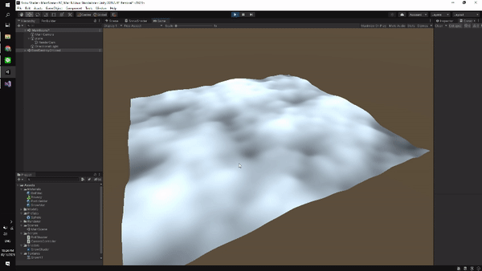
</div>
<br>

## Conclusion
In this tutorial we learn how to replicate the snow trail effect using Shader Graph in Unity. Using this technique, we can create dynamic environment that interacts with other objects.
