Have you seen liquids inside some small containers like bottles, vases, or glasses in a video games? Since they are not very conspicuous, usually games tend to ignore their simulation, however games like **Half-Life Alyx** have a very advanced liquid simulation inside a bottle that makes a lot of gamers astonished to how accurate they are.

In this tutorial, we are going to attempt to create liquid shader however in a simplified manner. This GIF below shows the final result, but I'm going to give you some tips on how to improve it in the last part of the tutorial if you are interested.

This is a considerably long tutorial so you don't have to finish it in one go. Make sure you understand the concepts, take a break, and come back later if necessary. If you encounter a problem when following the tutorial, you can check out the full source code from [SteveImmanuel/unity-liquid-wobble](https://github.com/steveimm/unity-liquid-wobble).

<div style="text-align:center">
  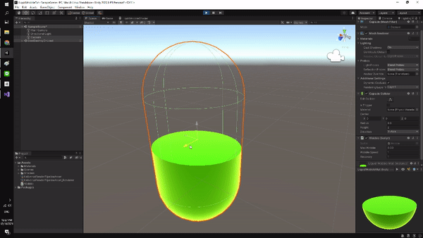
</div>
<br>

Before we start, this tutorial assumes you have the following requirements:
- Basic understanding of Unity
- Basic understanding of Shader
- Basic knowledge of linear algebra

## Project Setup
Let's create a new Unity project. We are going to use Universal Render Pipeline (URP) for this project, so you can choose the URP template or upgrade it later on once you are inside Unity.
<div style="text-align:center">
  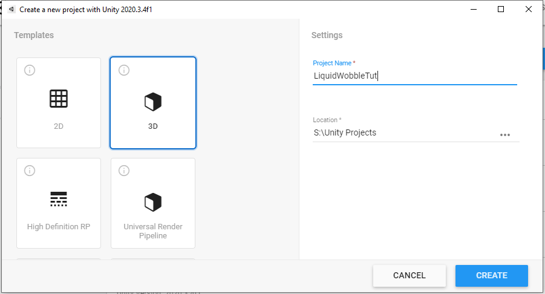
</div>
<br>

Next, we need to download the Shader Graph package from the Package Manager (```Window```->```Package Manager```). If you can't find it, make sure to choose the Unity Registry from the drop down menu. 
<div style="text-align:center">
  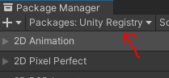
</div>

Make sure these two packages are installed.
<div style="text-align:center">
  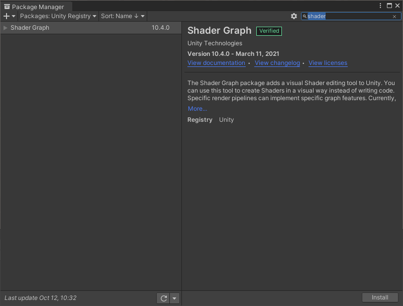
  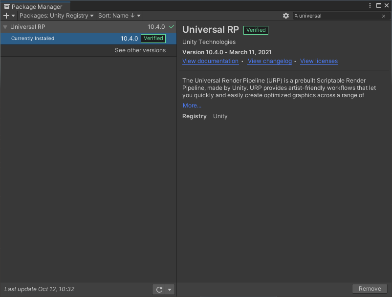 
</div>
<br>

## Scene Setup

Now, let's create a new basic 3D object. I am going to use a capsule for this tutorial.
<div style="text-align:center">
  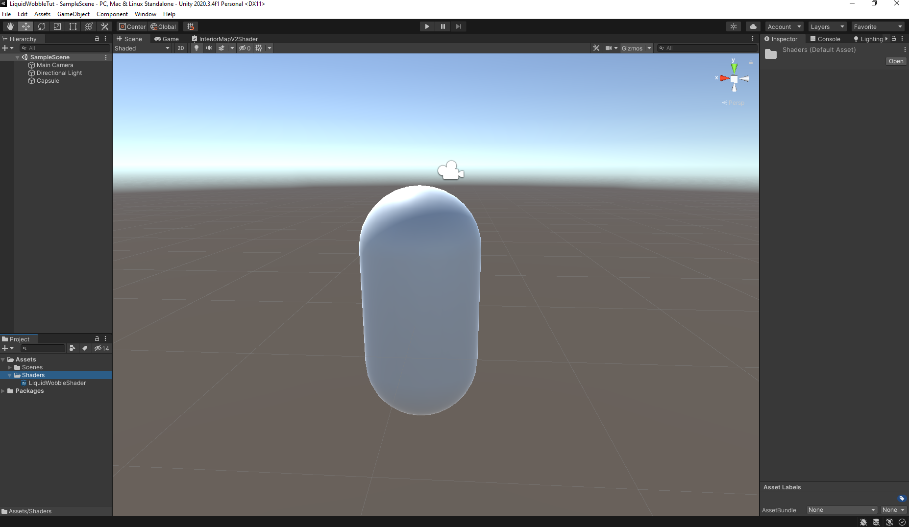
</div>
<br>

**Note**: Every object that is rendered will have a **shader**. If you don't specify them, Unity will use their default shader according to the render pipeline.
{: .notice--info}

In this case, we want to make our own custom shader. Usually artist will write their own shader in codes (HLSL or GLSL), however it is very complicated, hard to debug, and requires very high learning curve for a newbie. Luckily, there is also node-based approach that enables us to create our own shader easier, visually in a node-based manner. Unity provides their node-based shader called **Shader Graph** and we are going to use it. 

Create a new shader from the URP as shown in the picture below. Let's name it `LiquidWobbleShader`. Then, create a new material from that shader and name it `LiquidWobbleMat`. Assign the material to the capsule.

<div style="text-align:center">
  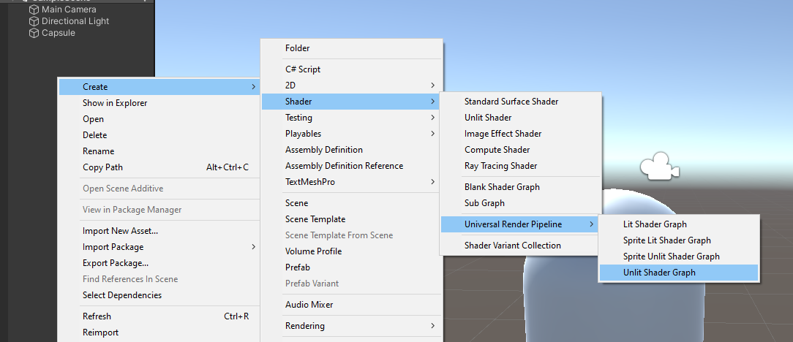
</div>
<br>
<div style="text-align:center">
  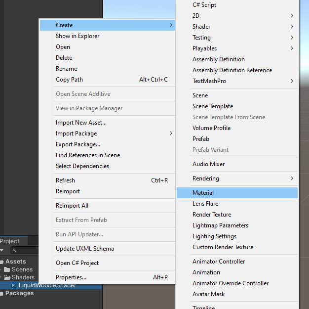
  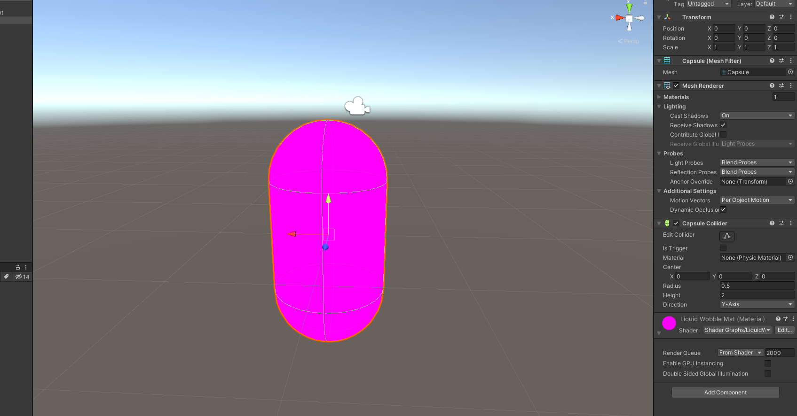
</div>
<br>

If you have a pink-colored capsule like I did in the picture above, that means you incorrectly setup the URP.

**Note**: The "Pink" shader is a Unity fallback shader in case it cannot render the objects based on the shader assigned to them.
{: .notice--info}

**If you don't encounter this issue, you can skip ahead to the next section.** To fix this issue, we need to create a new pipeline asset as shown in the picture below.

<div style="text-align:center">
  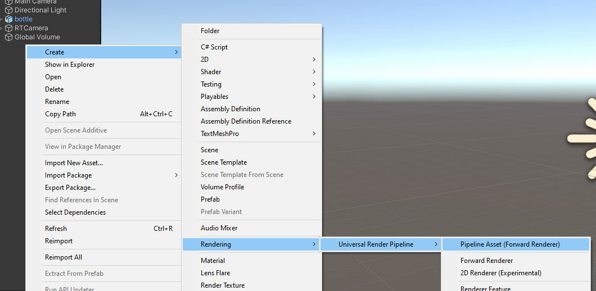
</div>
<br>

Open the project settings (`Edit`->`Project Settings`), navigate to `Graphics` and assign the new pipeline asset to the `Scriptable Render Pipeline Settings`

<div style="text-align:center">
  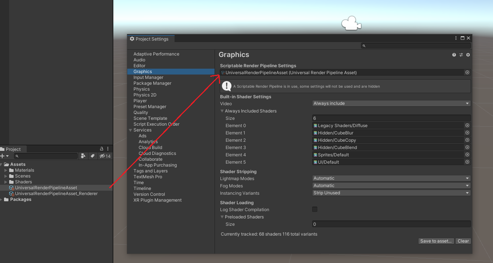
</div>
<br>

If you get it correctly, the capsule will look like this.
<div style="text-align:center">
  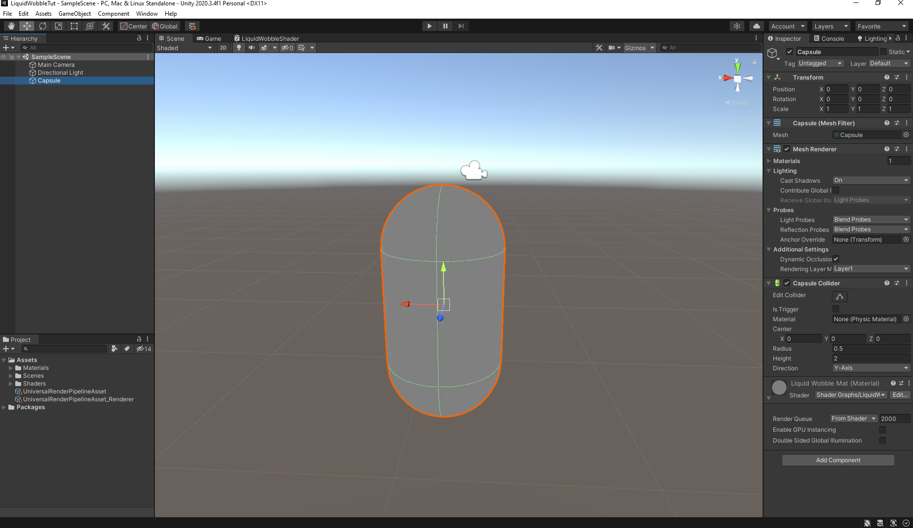
</div>
<br>


## Liquid Shader
This is the core, most crucial part of this tutorial. Let's open the shader graph editor by double clicking `LiquidWobbleShader` from the project hierarchy.

In the graph inspector, turn on `Alpha Clip` and `Two Sided` as we are going to need them.
- `Alpha Clip` makes the renderer ignore parts where the alpha is below a certain threshold.
- `Two Sided` makes the renderer renders both the front and back face of an object.

<div style="text-align:center">
  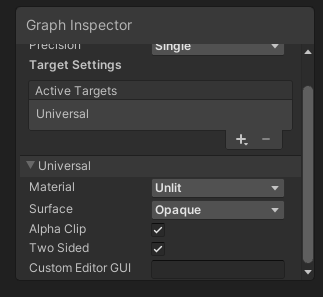
</div>
<br>

Before jumping to deep, you will notice that there are already two nodes in the editor, `Vertex` and `Fragment`.

<div style="text-align:center">
  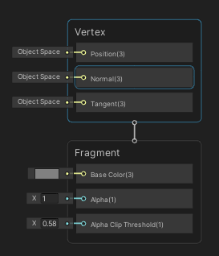
</div>
<br>

To put it simply, `Vertex Shader` is the shader part that does all the calculation of each vertices in an object, while `Fragment Shader` is the shader part that does all the calculation of each fragments/pixels that is being rendered in the scene.

Shader is difficult because you have to create series of operation that operates on **every single pixel** of an object and you have to do it all at once **not iteratively**. Therefore the operations must handle all kinds of condition for each pixel.

This shader consists of 3 main modules which are liquid fill, liquid color, and wobble effect.

**Note**: If you're having a hard time understanding what a node does, you can always refer to the [Official Documentation](https://docs.unity3d.com/Packages/com.unity.shadergraph@6.9/manual/Node-Library.html).
{: .notice--info}

### Liquid Fill
This module will take care of how much of a container is filled. We are going to use position attributes from the object to achieve this effect.

First, create a `Position` node. Press `space` and type on the name of the node you want and select it. Make sure that the position node is set to `World Space`.

<div style="text-align:center">
  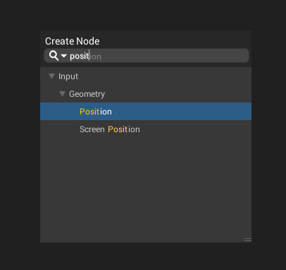
</div>
<br>

Next, create an `Object` node. Subtract the output of `Position` node to the `Position` output of the `Object` node using `Subtract` node. The result will look like the picture below.

<div style="text-align:center">
  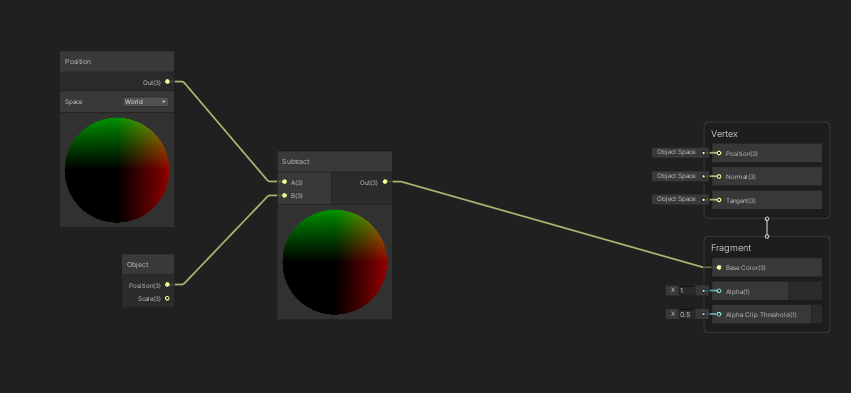
</div>
<br>

If you save the graph, you will get a result that look like this in your scene.

<div style="text-align:center">
  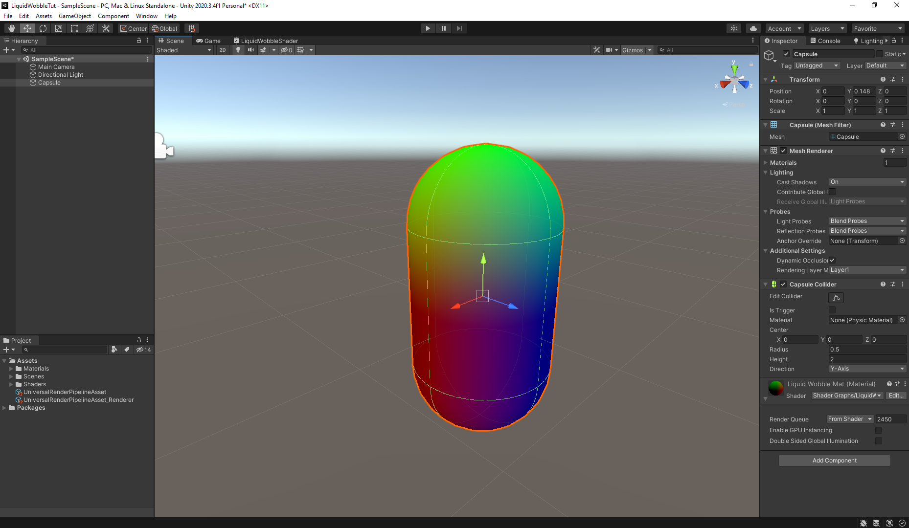
</div>
<br>

**Note**: You have to save the graph by pressing `Save Asset` in order for the shader to be recompiled and for you to see the result.
{: .notice--info}

Next, we need to use a `Step` node to make the shader only renders part of the object to get the fill effect. The fill effect is based on object's height so we are going to use the `y` component from the result before. To get only the `y` component, use `Split` node. Connect the `G` output from `Split` node to the `Edge` input of the `Step` node.

**Note**: In Shader Graph, the x, y, z, w components of a vector is equivalent to r, g, b, a components of a color, vice versa.
{: .notice--info}

Now, let's create a properties. Properties are something that we can tweak later on in the inspector or via C# script. Create a `Float` property and name it `Fill`. Drag that property and connect it to the `In` input of the `Step` node.

<div style="text-align:center">
  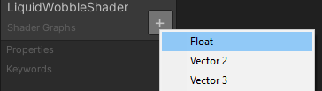
  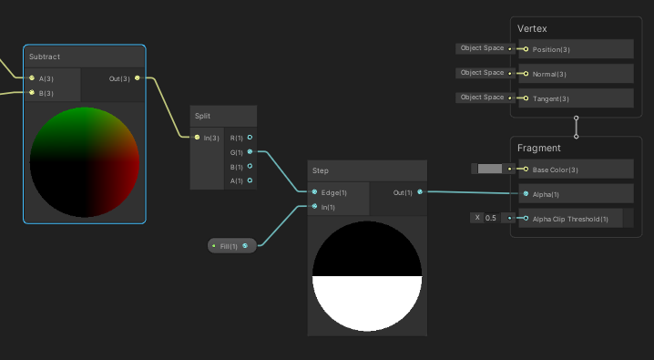
</div>
<br>

Save the graph and check your scene. If you tweak the `Fill` property from the inspector you will have a working fill effect on your object like below.

<div style="text-align:center">
  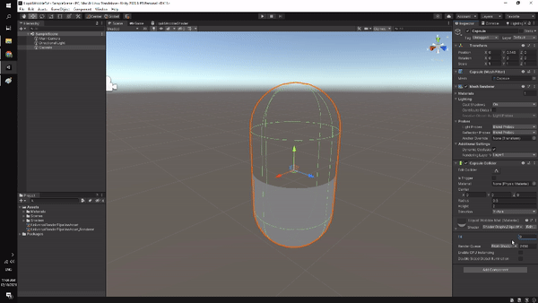
</div>
<br>

Now we can tidy things up a little bit by grouping all the nodes we made so far.

<div style="text-align:center">
  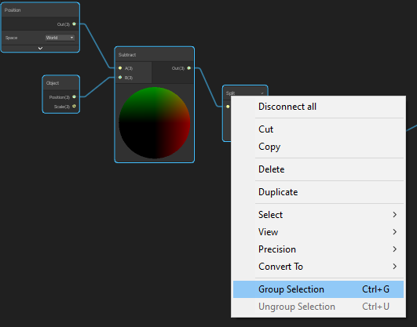
</div>
<br>

### Liquid Color
This module will handle the color of the liquid we want to show. You might notice that currently our liquid is looking hollow without lid. We are going to fix that first by rendering the backside of our object. This is why we enabled the `two-sided` option earlier.

<div style="text-align:center">
  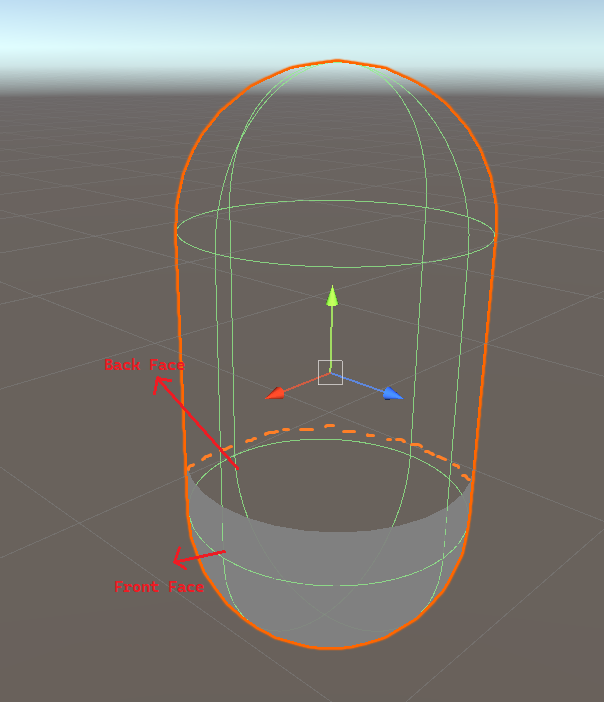
</div>
<br>

By default, the renderer will ignore the backside/back face of an object to save computation time as usually this part is not visible. As you can see the in the picture above, front face is the side that has normal vector pointing towards the camera, while back face is the opposite.

In our shader the color of the object is controlled by `Base Color` in the `Fragment` node. Let's create new properties and name it `SideColor` and `SurfaceColor` and don't forget to use HDR mode in the property setting because we will use it to add bloom effect later on. We will use a predicate node called `Is Front Face` to determine whether it is front face or back face.

<div style="text-align:center">
  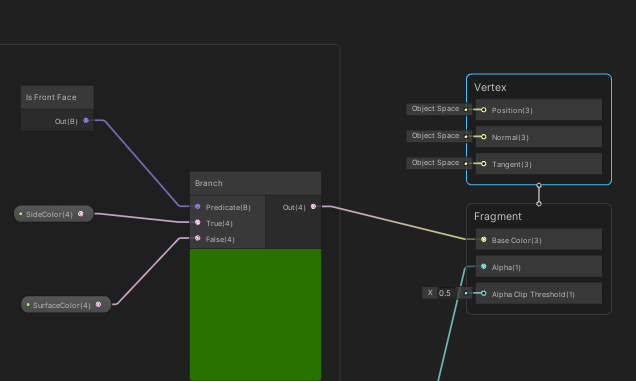
</div>
<br>

We are also going to use `Branch` node to handle if logic. Connect the output of `Is Front Face` node to the `Predicate` input of `Branch` node, and connect `SideColor` and `SurfaceColor` properties to the `Branch` node accordingly like in the picture above. What we are doing is basically telling the shader to use `SideColor` when rendering front face and `SurfaceColor` when rendering back face.

<div style="text-align:center">
  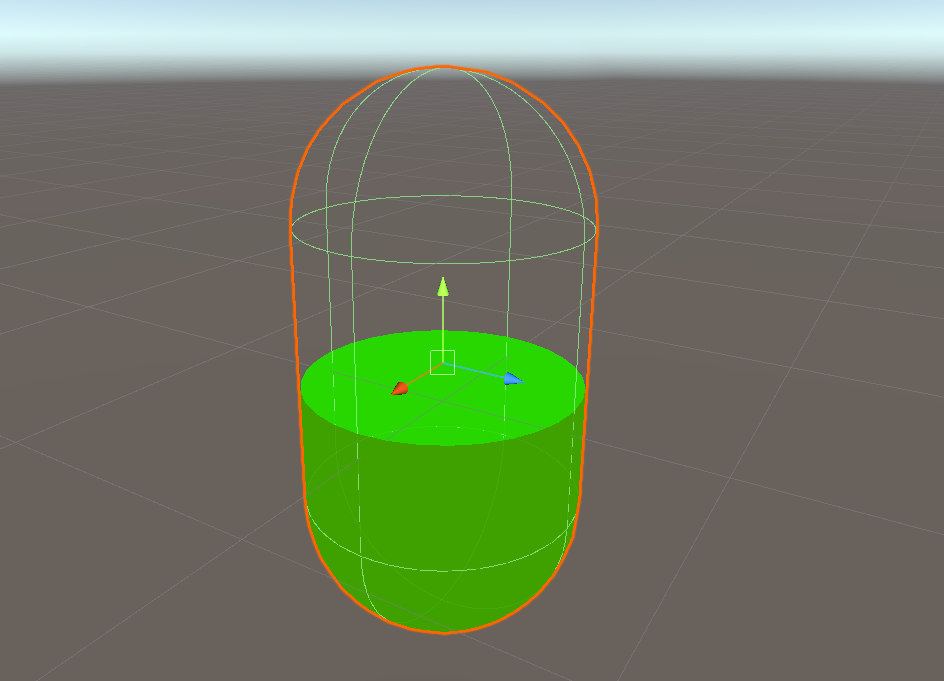
</div>
<br>

If you do everything correctly, you will get result like above.

**Note**: If your capsule color is black, that means you just haven't set the actual color on the `SideColor` and `SurfaceColor` properties. You can do that by going to the material property in the inspector.
{: .notice--info}

Now, let's spice things up a bit. We are going to integrate a new effect called Fresnel to our color. Fresnel is basically the reflectance you get based on a surface depending from the viewing angle.

Create new properties and name it `FresnelStrength` and `FresnelColor`. Next, add `Fresnel Effect` node to our graph, connect `FresnelStrength` to the `Power` input and multiply the output with `FresnelColor` property. Last, add the result with the `SideColor` property.

<div style="text-align:center">
  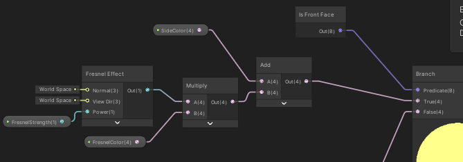
</div>
<br>

Do the same thing for the `SurfaceColor`, but use different `Fresnel Effect` node. This is important because our surface is actually **faked** by rendering the back face. Therefore, we can't use the normal vectors from our back face for our surface as they are completely different. We will fix this problem in later section.

You might be wondering when to use `Add` or `Multiply` node. A nice intuition, though might not apply in all situation, is use `Add` node when you want to add something **on top of** the other (i.e. stack), and use `Multiply` node when you want to **combine** something together, like color for example.

<div style="text-align:center">
  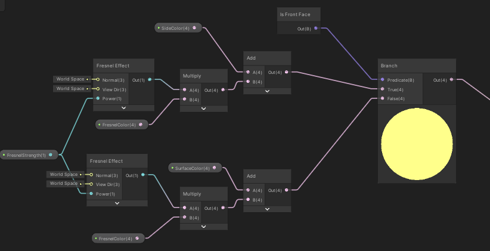
</div>
<br>

By now, you should see our capsule looking like the picture below. The gradient outline that you see is the fresnel effect. This is already looking much better than before!

<div style="text-align:center">
  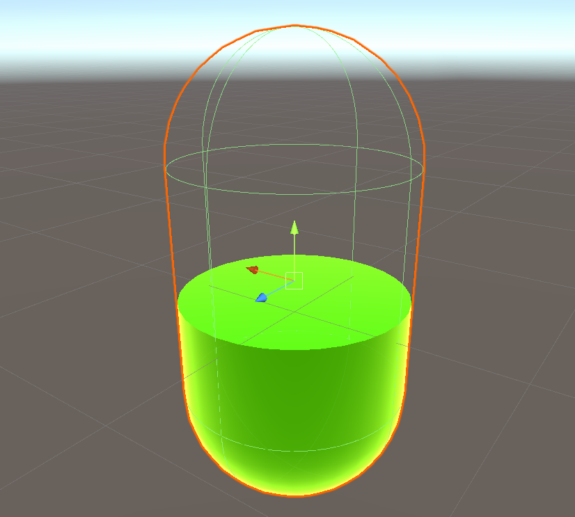
</div>
<br>

### Wobble Effect
This is the most important and hardest module to implement. This module basically takes care of the wobbling of our surface when our object moves. This will create the illusion that our object is a liquid and not just a static mesh.

First, create new properties `XRotation` and `ZRotation`. Under the reference in the property setting, set it to `_XRotation` and `_ZRotation` respectively. This has to be **exactly the same** because we are going to use it to control it from C# script later. Also, set the mode into `Slider` and clamp the value between -1 and 1.

<div style="text-align:center">
  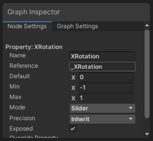
</div>
<br>

Next we are going to use 2 `Rotate About Axis` node. For input we need to use `Position` node but this time in `Object Space`. For the axis, use X axis and Z axis accordingly and set the rotation to 90. Multiply the output of each node with `XRotation` and `ZRotation` based on the axis and add the result together using `Add` node.

<div style="text-align:center">
  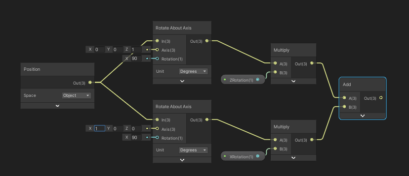
</div>
<br>

The graph should look like the picture above. Next add the output to our position from the first module as shown in the picture below. This will enable us to control the rotation of our surface in X and Z axis independently.

<div style="text-align:center">
  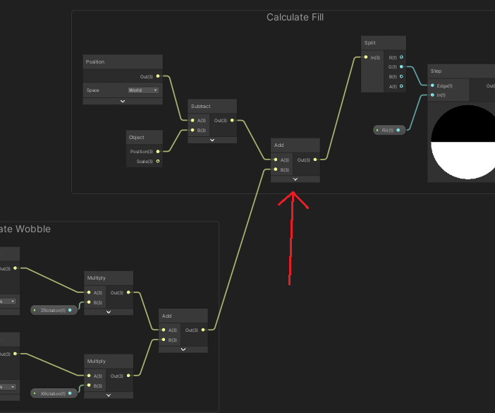
</div>
<br>

Save the graph and try playing around with the `XRotation` and `ZRotation` value from the inspector. You should see something similar like this.

<div style="text-align:center">
  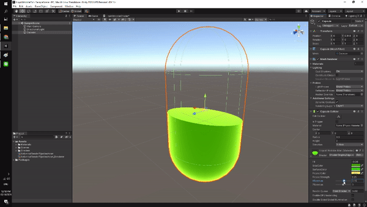
</div>
<br>

## Controlling the Shader
We are basically done implementing the basic functionality of our shader. What's left is to control the wobble effect programmatically.

In the capsule gameobject, add new C# Script component and name it `Wobble`. The name has to be `Wobble` if you want to use the code below otherwise you have to change the class name.

```csharp
using UnityEngine;

public class Wobble : MonoBehaviour
{
    Renderer rend;
    Vector3 lastPos;
    Vector3 velocity;
    Vector3 lastRot;
    Vector3 angularVelocity;
    public float maxWobble = 0.03f;
    public float wobbleSpeed = 1f;
    public float recovery = 1f;
    float wobbleAmountX;
    float wobbleAmountZ;
    float wobbleAmountToAddX;
    float wobbleAmountToAddZ;
    float pulse;
    float time = 0.5f;

    void Start()
    {
        rend = GetComponent<Renderer>();
    }

    private void Update()
    {
        time += Time.deltaTime;
        // decrease wobble over time
        wobbleAmountToAddX = Mathf.Lerp(wobbleAmountToAddX, 0, Time.deltaTime * (recovery));
        wobbleAmountToAddZ = Mathf.Lerp(wobbleAmountToAddZ, 0, Time.deltaTime * (recovery));

        // make a sine wave of the decreasing wobble
        pulse = 2 * Mathf.PI * wobbleSpeed;
        wobbleAmountX = wobbleAmountToAddX * Mathf.Sin(pulse * time);
        wobbleAmountZ = wobbleAmountToAddZ * Mathf.Sin(pulse * time);

        // velocity
        velocity = (lastPos - transform.position) / Time.deltaTime;
        angularVelocity = transform.rotation.eulerAngles - lastRot;

        // add clamped velocity to wobble
        wobbleAmountToAddX += Mathf.Clamp((velocity.z + (angularVelocity.x * 0.2f)) * maxWobble, -maxWobble, maxWobble);
        wobbleAmountToAddZ += Mathf.Clamp((velocity.x + (angularVelocity.z * 0.2f)) * maxWobble, -maxWobble, maxWobble);

        // keep last position
        lastPos = transform.position;
        lastRot = transform.rotation.eulerAngles;

        // send it to the shader
        rend.material.SetFloat("_XRotation", wobbleAmountX);
        rend.material.SetFloat("_ZRotation", wobbleAmountZ);
    }
}
```

Copy the code above to the script. That script will calculates what the surface should be pointing towards and contraint it to point towards upward over time by sine wave. The calculation result will then passed on to the shader and the shader will display the object accordingly.

And we are done! Play the game, move the object from the scene, and you should see something like this.

<div style="text-align:center">
  
</div>
<br>

## Polishing Up
This section is **optional**. If you think that you already have what you are looking for, then feel free not to follow this section.

### Fixing Surface Normal
As I pointed out earlier, we can't use back face normal vectors as our normal vectors for the surface. We need to calculate it based on where the surface is pointing at.

To do that, I'm going to recycle the logic from our second module in the liquid shader. We will rotate an upward vector (0, 1, 0) by the amount of `XRotation` and `ZRotation`.

<div style="text-align:center">
  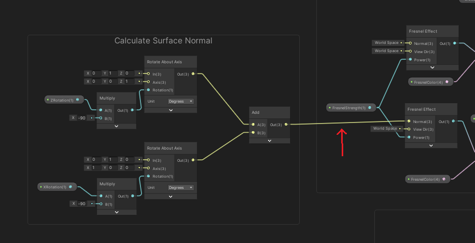
</div>
<br>

Then, connect the output to the `Normal` input of the `Fresnel Effect` node. Now, we will have a correct fresnel effect on the surface. The difference is quite subtle but is still noticable. 

### Post Processing
Let's go crazier by adding post processing. One of the most used post processing is called bloom. It is an effect to make bright objects glow.

<div style="text-align:center">
  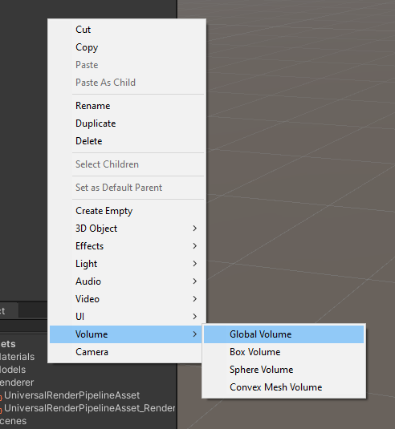
</div>
<br>

Create a new `Global Volume`, then create new profile. Add component called `Bloom` and enable the `Threshold` and `Intensity`. The `Threshold` controls how much intensity of an object must have in order for this effect to be applied, while `Intensity` controls the amount of glow effect.

<div style="text-align:center">
  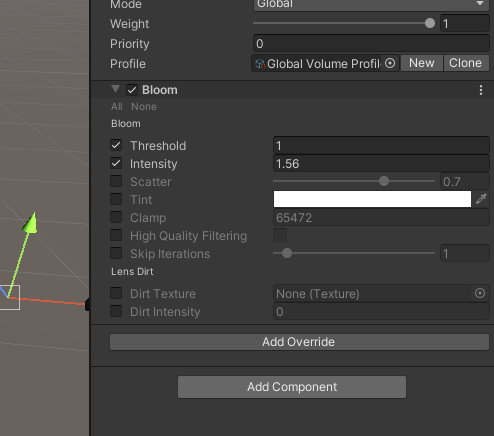
  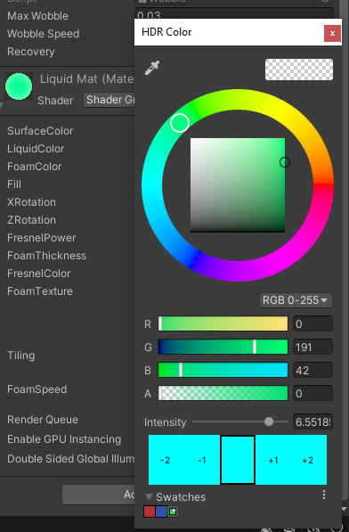
</div>
<br>

Next, bump up the color intensity of the shader material. I used a custom mesh that I made in Blender and here is the result.

<div style="text-align:center">
  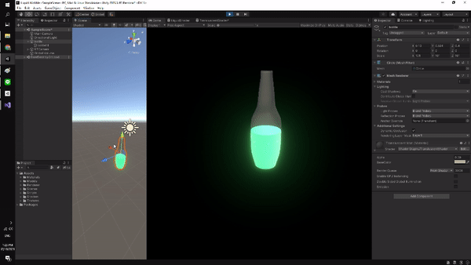
</div>
<br>

**Note**: If your only see the glow effect on the `Scene` but not in `Game`, you need to enable the post processing property on the `Main Camera` in the inspector.
{: .notice--info}

### Bubbles
You might realize that in real life, when we shake water in a bottle, it produces bubbles that floats up and then pops. We can also implement that in our shader.

I'm not going to explain this one in detail but I will give you my idea implementation because it is quite complicated and long, so I might revisit it for another tutorial.

To create the bubbles, I am using `Particle System`, `Render Texture` to capture the `Particle System` and apply the texture on top of the base color in our shader.

The result is quite nice. In the GIF below, I used a constant spawning bubbles but you could always control to spawn the bubbles only when bottle shakes for example via script.

<div style="text-align:center">
  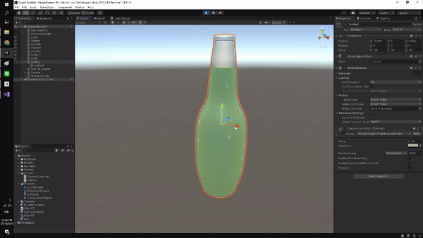
</div>
<br>

## Conclusion
In this tutorial we learn how to make simple liquid wobble shader in Unity using Shader Graph. We also learn about setting up URP, basic shader operations, rendering, and also customisation on how to extend and improve this shader further.