Visual effect is one of the most crucial part of video games which make the game goes from "meh" to "wow". Visual effect is not just some crazy explosions or smokes, but also something much more subtle like debris, trail from weapon being swung, or maybe sparks from collision. All those elements combined will make games more alive, real, and attractive for the player.

Unity introduces their graph based tool for creating visual effect called VFX graph. If you are already familiar with particle effects in Unity, the VFX graph is not that big of a leap from that. The main difference is that VFX graph utilizes GPU instead of CPU for the simulation so you can spawn millions of particles which are not possible when using particle effects.

In this tutorial, we are going to replicate the portal effect from the movie Marvel Dr. Strange. Even though it looks really impressive, it is actually quite simple to make this kind of effect. This GIF below shows the final result.

<div style="text-align:center">
  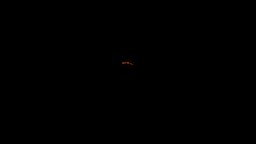
</div>
<br>

Note that this tutorial only covers from the aspect of visual effect and not the implementation of the portal **mechanics** because that would be a whole other tutorial itself (which I might do in the future).

The full source code for this project is available at [SteveImmanuel/unity-portal-vfx](https://github.com/steveimm/unity-portal-vfx.git). If you are really new to VFX graph, I highly suggest you to read [this other tutorial](https://hackmd.io/aBquDI0sTCOIP-CTxp6Rbg?view) first before going into this tutorial to get basic understanding of how it works.

Before we start, this tutorial assumes you have the following requirements:
- Basic understanding of Unity
- Basic familiarity of VFX graph
- Basic knowledge of linear algebra

## Project Setup
Let's create a new Unity project. We are going to use Universal Render Pipeline (URP) for this project, so you can choose the URP template or use the 3D template and then upgrade it later on once you are inside Unity.

<div style="text-align:center">
  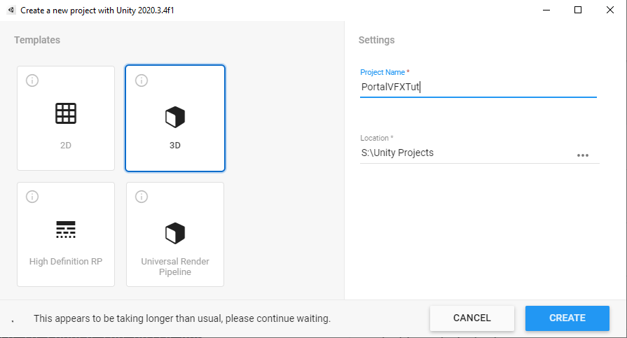
</div>
<br>

Next, we need to download the VFX Graph package from the Package Manager (```Window```->```Package Manager```). If you can't find it, make sure to choose the Unity Registry from the drop down menu. 

<div style="text-align:center">
  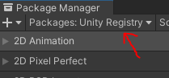
</div>

Make sure these two packages are installed.

<div style="text-align:center">
  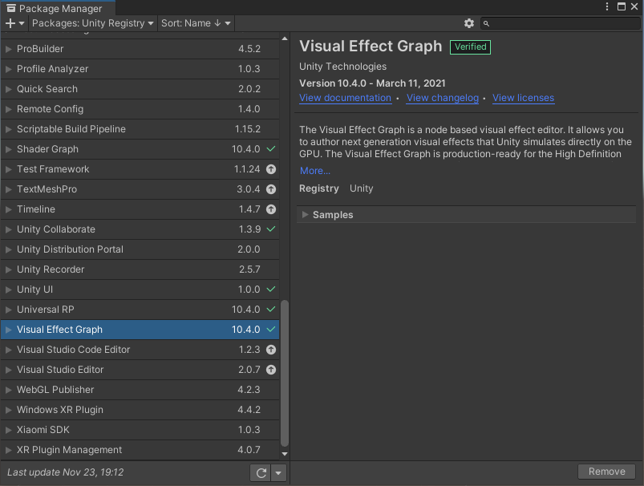
  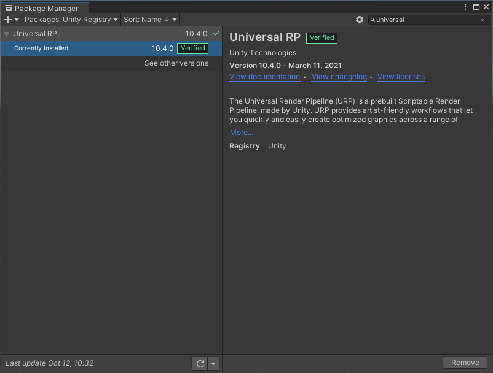 
</div>
<br>

## Scene Setup

Now, let's create the VFX graph. Right click in the project window and select `Create`->`Visual Effects`->`Visual Effect Graph` and name it `StaticPortalVFX`.

<div style="text-align:center">
  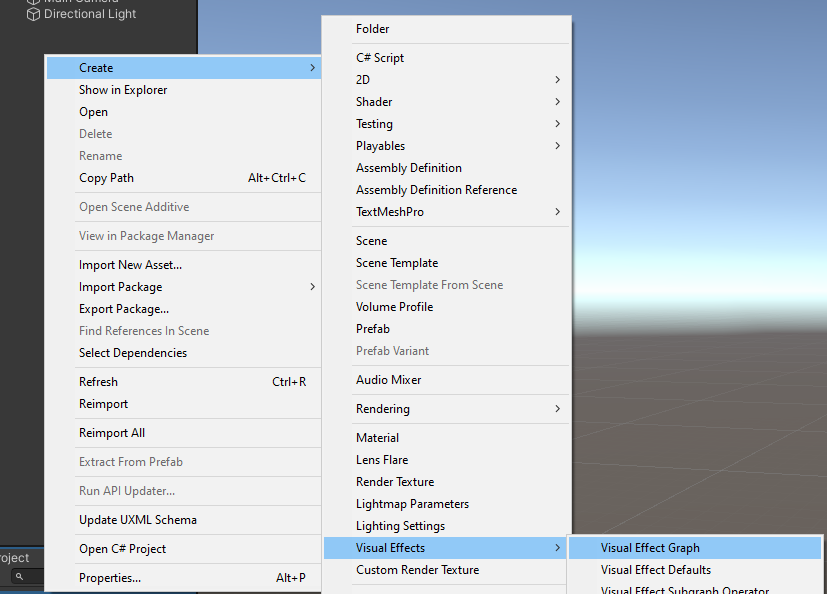
</div>
<br>

Drag the created VFX graph unto the scene. You should get the following result.

<div style="text-align:center">
  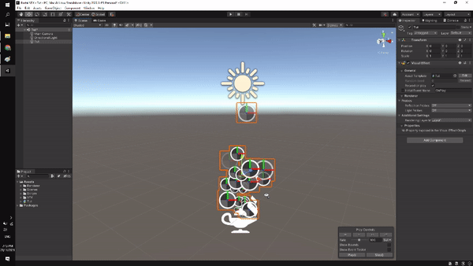
</div>
<br>

If you encounter a problem when setting up the URP, I recommend you check [my other tutorial](/posts/liquid-wobble/#scene-setup) on the `Scene Setup` subsection.
{: .notice--info}

## Portal VFX Graph
Let's open the graph editor by double clicking `StaticPortalVFX` from the project window. First, delete everything in the editor. You can easily do that by pressing `Ctrl+A`, then `Del`.

Next, press `space` and select `Simple Swarm Particle System`.

<div style="text-align:center">
  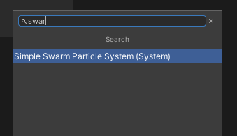
</div>
<br>

Right away, you should see particles being spawn from a sphere with random motion like the following.

<div style="text-align:center">
  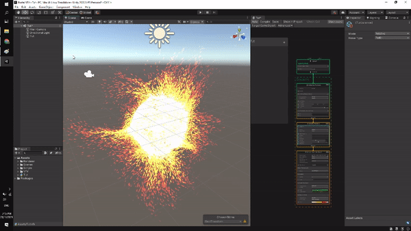
</div>
<br>

Create new `int` property and name it `SpawnRate`. Connect this property to 
the `Constant Spawn Rate` node. As the name suggests, this property controls the spawn rate of the system.

<div style="text-align:center">
  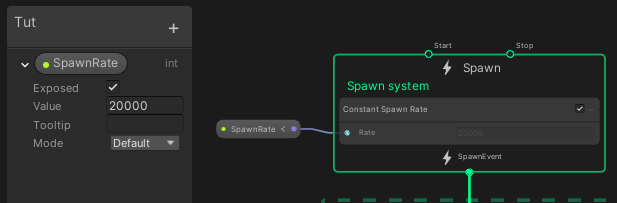
</div>
<br>

Change the simulation space to `World Space` by pressing the `LOCAL` symbol in the block. This will ensure that if you move around the VFX system, the particles will get left behind and not just follow around the center of the system.

<div style="text-align:center">
  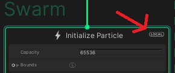
</div>
<br>

Let's move on to the `Initialize Particle` block. This block is responsible with how each particles is spawned. We want to spawn the particles in a circle to get the portal effect. To do that, we can use `Set Position (Shape: Torus)` node.

<div style="text-align:center">
  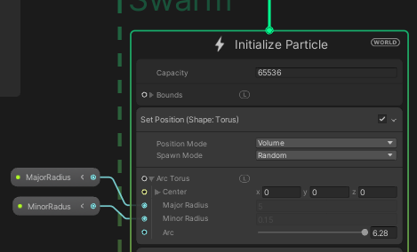
</div>
<br>

Create 2 new properties, name it `MajorRadius` and `MinorRadius` and connect it to the input accordingly. The `MajorRadius` will control how big the portal is, while the `MinorRadius` will control the width of the arc of the portal.

<div style="text-align:center">
  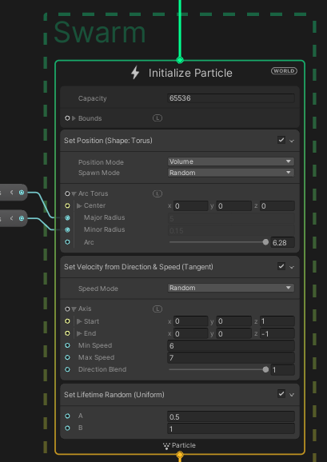
</div>
<br>

Next, we want each particle to move perpendicular to the center of the portal. To achieve this, we can set the particle velocity using `Set Velocity from Direction & Speed (Tangent)` node. Input 1 into the `Start` for the `z` component and -1 for the `End`. Leave other axis component as 0.

Save the graph, go back to the `Scene` and you should get result similar to the GIF below.

<div style="text-align:center">
  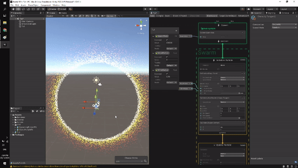
</div>
<br>

Play around with the hyperparameters in the graph (`Speed`, `Lifetime`, etc) to get your desired output.

The `Update Particle` block controls how the behaviour of each particle for each timestep. To make the movement more natural we can use the `Turbulence` node to add a little random noise for the movement of each particle. The image below shows the parameter value that I ended up using.

<div style="text-align:center">
  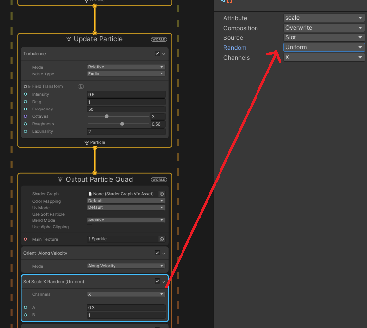
</div>
<br>

**Note:** You can configure each node even more from the inspector window.
{: .notice--info}

The last block is `Output Particle Quad`. This block is responsible for how each particle will be rendered, how it would look like. Use the `Orient: Along Velocity` node to control the orientation of each particle.

To add more variance, you can randomize the scale for each particle. In this case, I randomize the X-axis scale.

You might notice that in the movie, Dr. Strange's portal has longer particles, kinda like a rod. We can achieve this effect by modifying the scale in Y-axis. To make it look more natural, we can scale the Y-axis little by little as the time goes by using `Set Scale.Y over Life` node. This will give a "growing" effect for each particle. Control the scale using curve to represent the scale value based on the particle's lifetime.

<div style="text-align:center">
  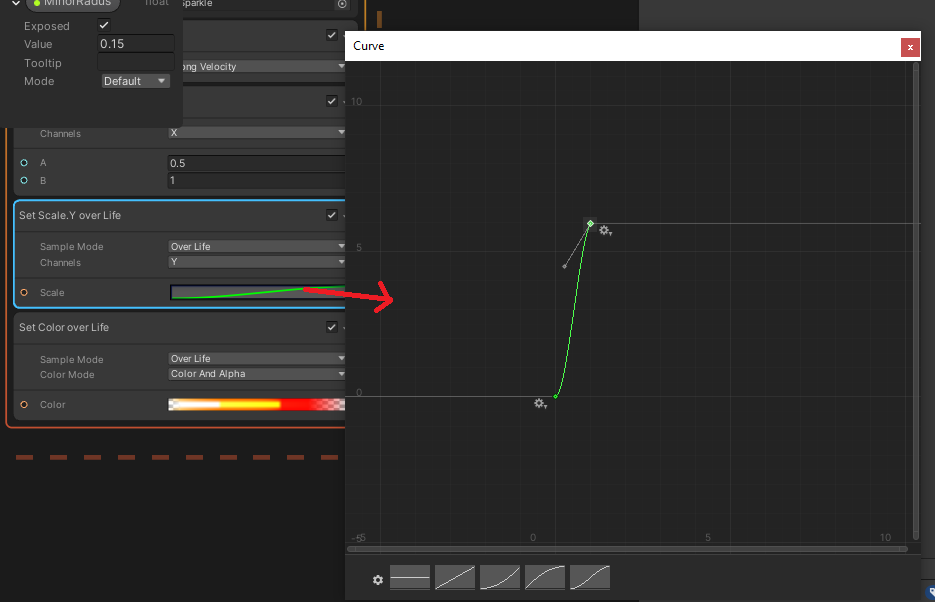
</div>
<br>

You can also control the color of the particles using `Set Color over Life` node. I used a gradient of orange color to replicate the portal color from the movie. In this context, the leftmost part of the color represents the color when the particle is spawned while the rightmost represents the color when the particle dies. Notice that the alpha value for the leftmost and rightmost part is 0. This will give a fade in and fade out effect so that the particle doesn't just pop in when it is spawned and disappear suddenly when it dies.

<div style="text-align:center">
  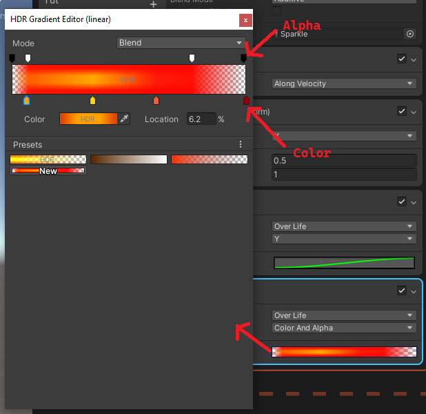
</div>
<br>

If you follow everything correctly, you should get the following result.

<div style="text-align:center">
  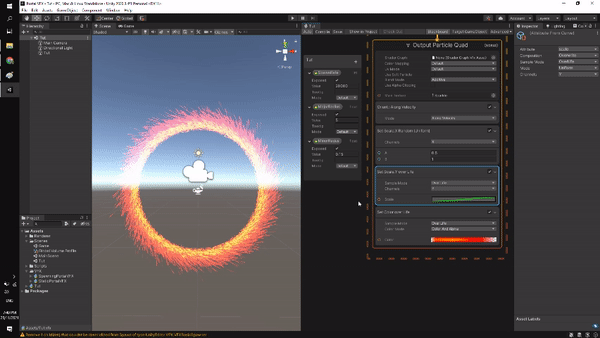
</div>
<br>

And that's basically it. Congratulations, you have just successfully create the portal effect. 

## What's Next
In this section, I am going to explain how to **spawn** the portal slowly and configure scene **lighting** to make it more immersive. First, we need to duplicate the VFX graph that we just created and name it `SpawningPortalVFX`. Open it and in the `Set Position (Shape: Torus)` node, change the `Spawn Mode` to `Custom`. Create new float property to control the `Arc Sequencer` input and name it `ArcSequencer`.

<div style="text-align:center">
  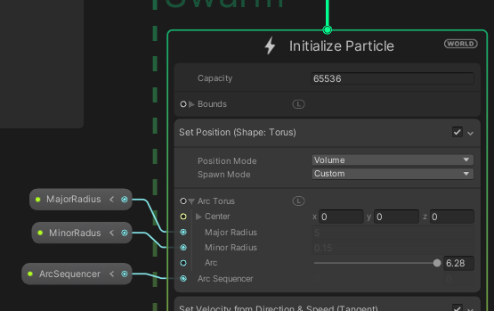
</div>
<br>

Now, you can control the spawn point of the particles in the circle arc.

<div style="text-align:center">
  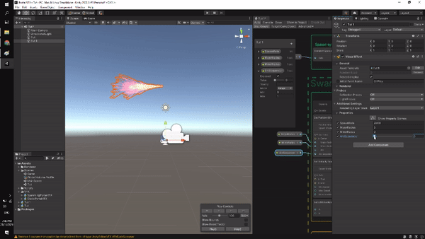
</div>
<br>

**Note:** I only did this part because I was not able to control the `Spawn Mode` from C# script, if you happen to be able to, then you may not need to duplicate the VFX graph.
{: .notice--info}

Next, select the VFX graph from the project window, then in the inspector, remove the `Initial Event Name`. This will ensure that the VFX system doesn't immediately spawn because we want to control it from C# script.

<div style="text-align:center">
  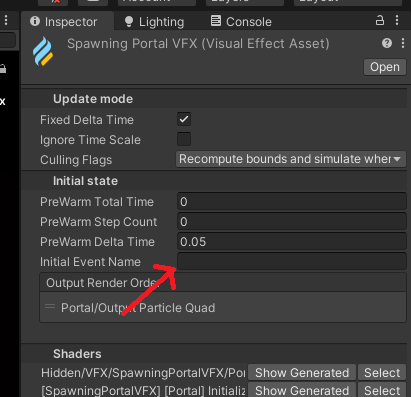
</div>
<br>

To add the glowing effect, we need to use post processing. Create a global volume from the hierarchy. Then, create a new profile and add override of `Bloom`. 

<div style="text-align:center">
  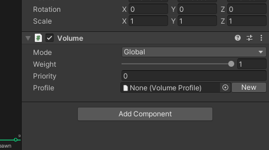
  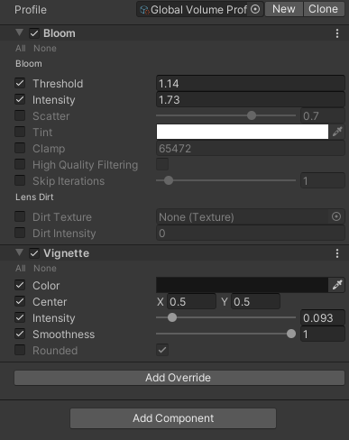
</div>
<br>

The `Intensity` controls how much of a glow the object will emit while `Threshold` controls the minimum amount of object's color intensity before it can glow.

I also add `Vignette` override to give a more filmic-look to the result.

<div style="text-align:center">
  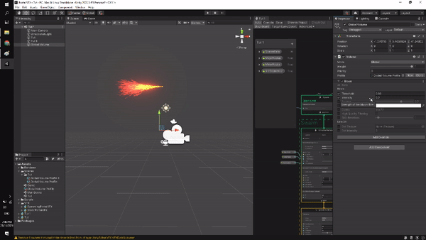
</div>
<br>

**Note:** Don't forget to enable the `Post Processing` property in the inspector window of the main camera.
{: .notice--info}

Last, let's configure the lighting. Remove the ambient lighting in the scene because we want our VFX system to be the only source of light. Open the lighting window from `Window`->`Rendering`->`Lighting` and select the `Environment` tab. Choose `None` for the `SkyBox Material` and complete black for the `Ambient Color`. You should see that the scene now looks very dark.

<div style="text-align:center">
  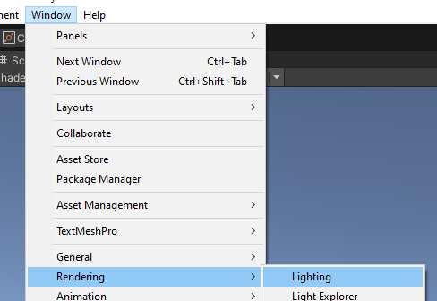
  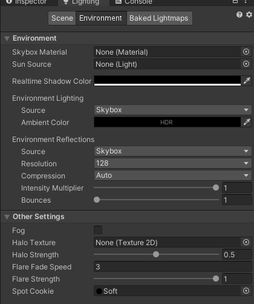
</div>
<br>

Even though we have created the glow effect from the particles, it **does not** contribute to the environment lighting because it comes from **emmisive material**. To make it do so, we need to bake the lighting map. But, since the particles move around, we can't use baked data because it always changes.

The workaround is we "fake" the lighting using other lighting system that supports realtime. Right click in the `Hierarchy` and select `Light`->`Point Light`. Set the light intensity to 0 as we want to control it later from the C# script. Configure the objects hierarchy as shown in the image below.

<div style="text-align:center">
  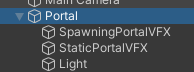
</div>
<br>

Create an enclosed room using 6 cube blocks and place the `Portal` inside those blocks. If you move your view inside the room you will see a pitch black color. To help you see inside that room, you can disable the scene lighting (this setting only affects the `Scene` window, not the actual game) by pressing the light icon as shown in the GIF below.

<div style="text-align:center">
  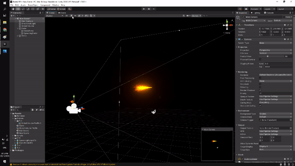
</div>
<br>

Create a C# script to control the spawn sequence of the portal. You can do it by yourself or simply copy the code below.

```csharp
using System.Collections;
using System.Collections.Generic;
using UnityEngine;
using UnityEngine.VFX;

public class PortalSpawner : MonoBehaviour
{
    public float maxRotationSpeed;
    public float majorRadius;
    public float spawnDuration;
    public int spawnRate;
    public float lightIntensity;
    public AnimationCurve spawnCurve;
    public VisualEffect spawningPortal;
    public VisualEffect staticPortal;
    public Light lightPortal;


    private bool hasPlayed;
    private Coroutine spawnCoroutine;

    private void Awake()
    {
        hasPlayed = false;
    }

    void Update()
    {

        if (Input.GetKeyDown(KeyCode.Space))
        {
            if (hasPlayed)
            {
                hasPlayed = false;
                StopSpawnSequence();
            }
            else
            {
                hasPlayed = true;
                spawnCoroutine = StartCoroutine(SpawnSequence());
            }
        }
    }

    private void StopSpawnSequence()
    {
        StartCoroutine(TurnOffLight(1f));
        spawningPortal.Stop();
        staticPortal.Stop();
        StopCoroutine(spawnCoroutine);
    }

    private IEnumerator SpawnSequence()
    {
        float arcSequencer = 0;
        float elapsedTime = 0;
        bool staticPortalPlayed = false;
        spawningPortal.Play();

        while (elapsedTime < spawnDuration)
        {
            float progress = elapsedTime / spawnDuration;
            float rotationSpeed = Mathf.Clamp(progress * maxRotationSpeed, 1, maxRotationSpeed);

            elapsedTime += Time.deltaTime;
            arcSequencer = ((arcSequencer + Time.deltaTime) * rotationSpeed) % 1;

            float currentMajorRadius = Mathf.Clamp(majorRadius * spawnCurve.Evaluate(progress), .2f * majorRadius, majorRadius);
            float currentMinorRadius = Random.Range(0, .03f);
            int currentSpawnRate = (int)Mathf.Clamp(spawnRate * spawnCurve.Evaluate(progress), 500, .3f * spawnRate) + Random.Range(-250, 250);
            float currentLightIntensity = lightIntensity * spawnCurve.Evaluate(progress);

            spawningPortal.SetFloat("ArcSequencer", arcSequencer);
            spawningPortal.SetFloat("MajorRadius", currentMajorRadius);
            spawningPortal.SetFloat("MinorRadius", currentMinorRadius);
            spawningPortal.SetInt("SpawnRate", currentSpawnRate);
            lightPortal.intensity = currentLightIntensity;

            if (progress > .5f)
            {
                if (!staticPortalPlayed)
                {
                    staticPortal.Play();
                    staticPortalPlayed = true;
                }
                staticPortal.SetFloat("MajorRadius", currentMajorRadius);
            }

            yield return null;
        }

        staticPortal.SetInt("SpawnRate", spawnRate);
        spawningPortal.Stop();
        yield return null;
    }

    private IEnumerator TurnOffLight(float duration)
    {
        float initialIntensity = lightPortal.intensity;
        float targetIntensity = 0;

        float elapsedTime = 0;
        while (elapsedTime < duration)
        {
            lightPortal.intensity = Mathf.Lerp(initialIntensity, targetIntensity, elapsedTime / duration);
            elapsedTime += Time.deltaTime;
            yield return null;
        }

        lightPortal.intensity = targetIntensity;
    }
}
```

Place the script in the `Portal` gameobject. Change the parameters however you like. This is the parameters value that I used to get the end result.

<div style="text-align:center">
  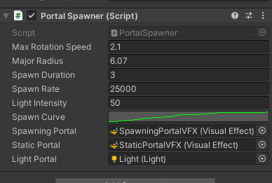
</div>
<br>

The script will make the `SpawningPortalVFX` spawns first, slowly from a small radius and gets gradually bigger. The light intensity also increases slowly as the portal gets bigger. Then, after it creates a full circle, `SpawningPortalVFX` will be stopped and `StaticPortalVFX` will be played. Since everything happens slowly, it will look like the portal is the same object while actually it comes from 2 different but similar VFX system.

Press play, then `Space` to spawn/despawn the portal. You should get result similar to the GIF below.

<div style="text-align:center">
  
</div>
<br>

## Conclusion
In this tutorial we learn how to replicate the portal effect from the movie Dr. Strange using Unity VFX graph. We also learn how to configure realtime lighting and post processing to create a more interesting scene result.