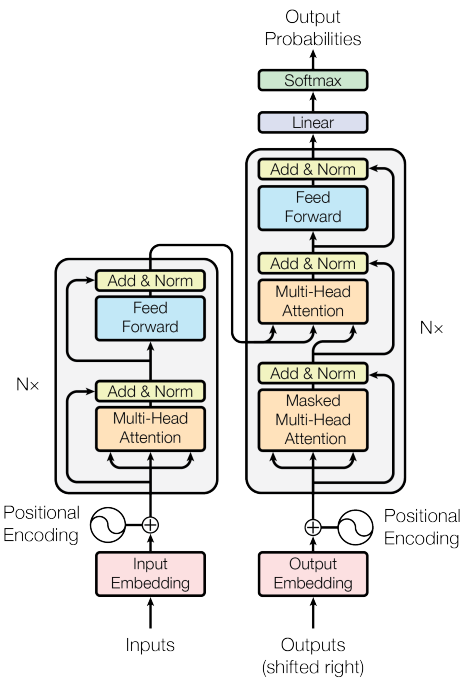
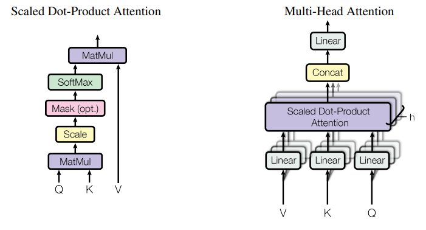
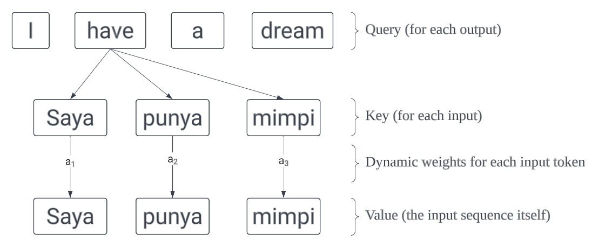
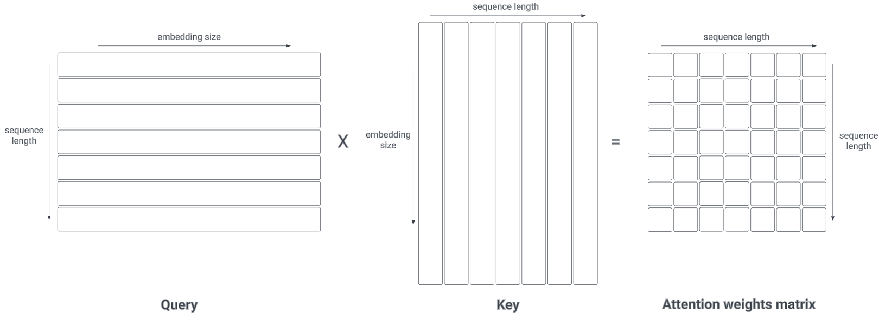
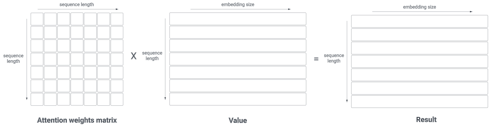

This post contains a key concept of how and why transformers architecture works. It is intended to be a quick reference so it assumes some fundamental knowledge of transformers. The original paper can be read [here](https://proceedings.neurips.cc/paper_files/paper/2017/file/3f5ee243547dee91fbd053c1c4a845aa-Paper.pdf).

{: .align-center}

{: .align-center}

## Intuitive Objective
The idea is to find **global dynamic weights** to represent how **each** token in the output pays attention to **each** token in the input. Therefore, each token in the output will have different attention weights to one another.

## Attention Mechanism
The attention mechanism consists of 3 main components, which are **Query**, **Key**, and **Value**. To quote from [here](https://stats.stackexchange.com/questions/421935/what-exactly-are-keys-queries-and-values-in-attention-mechanisms):
> The key/value/query concept is analogous to retrieval systems. For example, when you search for videos on Youtube, the search engine will map your query (text in the search bar) against a set of keys (video title, description, etc.) associated with candidate videos in their database, then present you the best matched videos (values).

{: .align-center}

Another intuitive explanation is that we want to extract relevant information from the **Value** based on a certain **Query**. Each **Value** has a corresponding **Key**. The **Query** is paired with the **Key** of the values to calculate the relevance of each **Value** with respect to the **Query**.

### Scaled Dot-Product Attention
Notice the formula of calculting the attention mechanism as follows:

$$ Attention(Q, K, V) = softmax(\frac{QK^T}{\sqrt{d_k}})V $$

All $$Q$$, $$K$$, and $$V$$ are matrices. Each row in $$Q$$ and $$K$$ has dimension of $$d_k$$, while each row in $$V$$ has dimension of $$d_v$$ ($$d_k$$ does not necessarily have to be different with $$d_v$$). The softmax part of the equation is the global dynamic weight matrix that is mentioned earlier.

{: .align-center}

Notice that token in the $$Q$$ sequence is multiplied with **every** token in the $$K$$ sequence. By multiplying $$Q$$ and $$K^T$$, we get a square matrix scaled by $$\sqrt{d_k}$$. Hence, we need divide it to by $$\sqrt{d_k}$$ to normalize it back.

To illustrate why the dot products get large, assume that the components of vector $$q$$ and $$k$$ are **independent** random variables with mean of 0 and variance of 1. Their dot product, $$q · k = \sum_{i=1}^{d_k} q_i k_i $$. Notice that:

$$\begin{eqnarray} 
\mathrm{E}[q.k] &=& \mathrm{E}[q_1k_1 + ... + q_{d_k}k_{d_k}] \\
                &=& \mathrm{E}[0] \\
                &=& 0 \\
\end{eqnarray}$$

$$\begin{eqnarray} 
\mathrm{Var}[q.k] &=& \mathrm{Var}[q_1k_1] + ... + \mathrm{Var}[q_{d_k}k_{d_k}] \\
                &=& d_k \\
\end{eqnarray}$$

After that we apply softmax function in the column dimension. The idea is so that every single row sums up to 1.

### Multi-Head Attention
Finally, we multiply the result from the scaled dot-product with the $$V$$ matrix. Notice that each element in a row controls how much attention for each token in $$V$$.

{: .align-center}

Ideally, we want to compute the attention mechanism using the whole matrices. However, it is not always computationally feasible when the matrices are large. Instead, we can divide $$d_k$$ into several heads and compute the attention mechanism for each of them, then concantenate them back together. This is called **multi-head attention**.

### Self-Attention
This term refers to the encoder part of the transformers. In this case, the $$Q$$, $$K$$, and $$V$$ matrices are all the same. The intuition is that we want to extract relevant information from the input sequence itself.

## Positional Encoding
Transformer can process all the input sequence in parallel, unlike RNN. Consequently, it does not have any information about the order of the sequence. To solve this problem, we add positional encoding to inject the positional infomation. The formula is as follows:

$$\begin{eqnarray}
PE_{(pos, 2i)} = sin(\frac{pos}{10000^{2i/d_{model}}}) \\
PE_{(pos, 2i+1)} = cos(\frac{pos}{10000^{2i/d_{model}}}) \\
\end{eqnarray}$$

where $$d_{model}$$ can be $$d_k$$ or $$d_v$$.