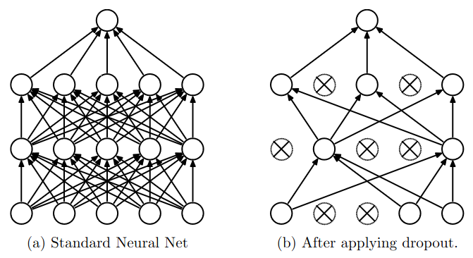
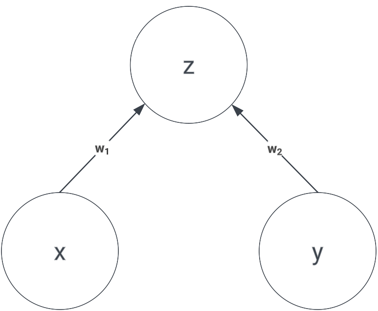

Original paper can be found [here](https://www.cs.toronto.edu/~hinton/absps/JMLRdropout.pdf).

## Overview 
Dropout is a regularization technique to prevent overfitting when training a neural network. It works by randomly "dropping out" some neurons during training. This works by preventing the network from relying too much on any one feature or some set of features (**co-adaptation** of features). The added stochasticity forces the network to learn more robust features that are useful in conjunction with many different random subsets of the other neurons.

{: .align-center}

Another way to think about dropout is that it is a way to train an **ensemble** of networks but only on a single network. Each time we train the network, we randomly drop out some neurons. This means that each time we train the network, we are "training" a different network. The final network is an ensemble of all the networks we trained.

## The Math Behind Dropout
Without a loss of generality, consider a very simple neural network consisting of 2 neurons as shown in the image below.

{: .align-center width="40%"}

We can calculate $$z$$ as:

$$ z = w_1x + w_2y$$

Now, let's say we apply dropout with probability of $$p$$ for dropping the neuron. For such small case like this, we can analytically calculate the expected value of $$z$$ by figuring out all the sample states, which are:
- $$x$$ and $$y$$ are not dropped, the probability is $$(1-p)^2$$
- $$x$$ is dropped, $$y$$ is not dropped, the probability is $$p(1-p)$$
- $$x$$ is not dropped, $$y$$ is dropped, the probability is $$(1-p)p$$
- $$x$$ and $$y$$ are dropped, the probability is $$p^2$$

Therefore, the expected value of $$z$$ is:

$$\begin{eqnarray}
z &=& (1-p)^2(w_1x + w_2y) + p(1-p)(0 + w_2y) + (1-p)p(w_1x + 0) + p^2(0 + 0) \\
  &=& (1-p)^2(w_1x + w_2y) + p(1-p)(w_1x + w_2y) \\
  &=& (1+p^2-2p+p-p^2)(w_1x + w_2y) \\
  &=& (1-p)(w_1x + w_2y)
\end{eqnarray}$$

So, the expected value of $$z$$ is simply multiplying the original result without dropout with $$1-p$$.

## Dropout in Practice
Implementing dropout is very simple, we can simply create a mask with the same shape as the input and apply an element-wise multiplication. The mask is a binary matrix with probability of $$p$$ to be 1 and $$1-p$$ to be 0. The mask is different for each training step.

```python
def train_step(x):
    h1 = np.maximum(0, np.dot(W1, x) + b1)
    u1 = np.random.rand(*h1.shape) > p
    h1 *= u1
    out = np.dot(W2, h1) + b2

def test_step(x):
    h1 = np.maximum(0, np.dot(W1, x) + b1)
    h1 *= (1-p)
    out = np.dot(W2, h1) + b2
```

Dropout layer **behaves differently** during training and testing. Notice that we need to scale the output by $$1-p$$ during testing to ensure that the expected value of the output is the same as during training. This is why in PyTorch, there are `model.train()` and `model.eval()` functions to switch between training and evaluation mode.  

To even more optimize it, we can perform the scaling during training instead of during testing. This is called **inverted dropout**. The idea is to scale **down** the output by $$1-p$$ during training so that we don't need to scale it at all during testing. At test time, we care more about the speed of inference which is why we want to eliminate as many operations as possible. This is the implementation of inverted dropout:

```python
def train_step(x):
    h1 = np.maximum(0, np.dot(W1, x) + b1)
    u1 = (np.random.rand(*h1.shape) > p) / (1-p)
    h1 *= u1
    out = np.dot(W2, h1) + b2

def test_step(x):
    h1 = np.maximum(0, np.dot(W1, x) + b1)
    out = np.dot(W2, h1) + b2
```