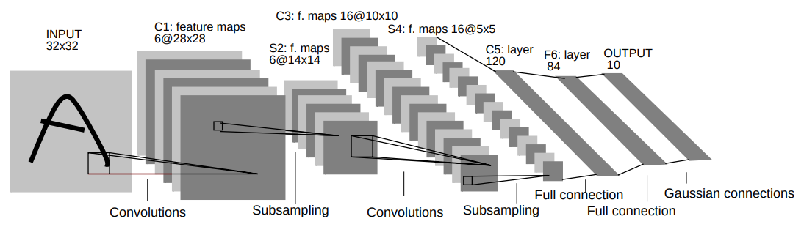
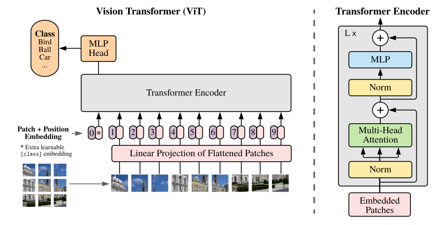
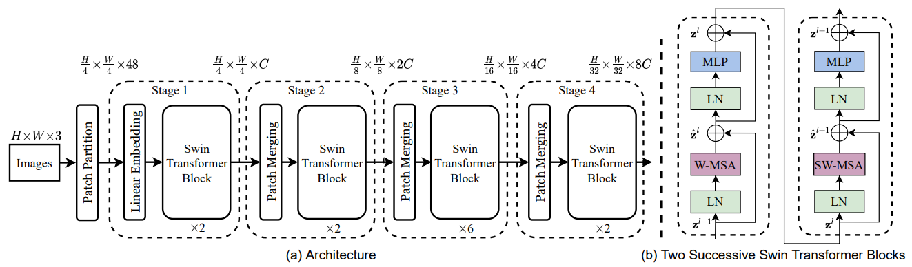

## Fully Connected Layer
The most naive approach to process an image is to flatten all of its pixels into a vector and feed it into a fully connected layer.

Pros:
- Very easy and straightforward to implement.

Cons:
- It does not take into account spatial information of the pixels, i.e., each pixel is treated as an independent feature.
- The number of parameters grows quadratically with the image size. For example, a 224x224 RGB image has already consumes 150k parameters.

## Convolutional Neural Network
[CNN](http://vision.stanford.edu/cs598_spring07/papers/Lecun98.pdf) has been around since 1998. The main idea of CNN is the filter/kernel that is applied for each patch of the image. This filter is shared across the entire image. The value of the filter is learned during training.

{: .align-center}

Pros:
- It takes into account spatial information of the pixels due to the convolution operation.
- The number of parameters is controlled by the filter size and the number of filter, which is independent of the image size.

Cons:
- Cannot capture long-range dependencies between pixels that are located faraway (depending on the filter size).

## Vision Transformer
After the booming of transformer in NLP, it is also adopted to the vision domain. The first work that introduces it is [ViT](https://arxiv.org/pdf/2010.11929.pdf). The main idea is to treat the image as a sequence of patches. Each patch is flattened into a vector and fed into a transformer encoder. 

{: .align-center}

Pros:
- It can capture long-range dependencies between pixels because each pixel can attend to every other pixel.

Cons:
- It inherits the computational limitation of transformers in which the computational cost grows quadratically with the sequence length.
- Transformer lacks inductive biases inherent to CNN, such as translation equivariance and locality.

## Swin Transformer
Motivated by the problems in ViT, [Swin-ViT](https://arxiv.org/pdf/2103.14030.pdf) proposes a new architecture that combines the best of both worlds. The main idea is to perform the self-attention mechanism but only on patches of the image instead of the whole image as in ViT. This way the computational cost does not grow quadratically with the image size. Moreover, this also introduce back the inductive biases that are inherent to CNN.

{: .align-center}

Pros:
- Significantly lower number of parameters compared to ViT, but achieves better performance.

Cons:
- The computational cost is still high compared to CNN.