This post contains survey of notable prompt engineering techniques. 

Prompt engineering refers to a way to construct a natural language in such a way to feed to the LLM in order to improve the performance. In this domain, the assumption is that the LLM is a **blackbox** therefore cannot be directly optimized, so the improvement must come from the prompt or other external parameters.

There are abundant amount of prompt techniques but the trade-off is usually between the **performance improvement** and the **cost**, e.g. inference time, numer of tokens, cost of using the LLM, additional models, etc.

Directly feeding the original prompt without any modifications to the LLM is refered to as **zero-shot** strategy. It is fast, easy, but the performance is not good on complex task.

## Expanding the Prompt

### [Few-Shot / In-Context Learning](https://arxiv.org/pdf/2005.14165.pdf)

Give the LLM several demonstrations of the expected interactions before giving the actual prompt.
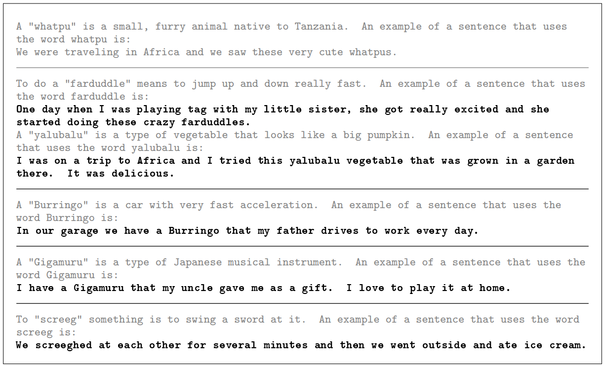{: .align-center}

### [Generate Knowledge](https://arxiv.org/pdf/2110.08387.pdf)

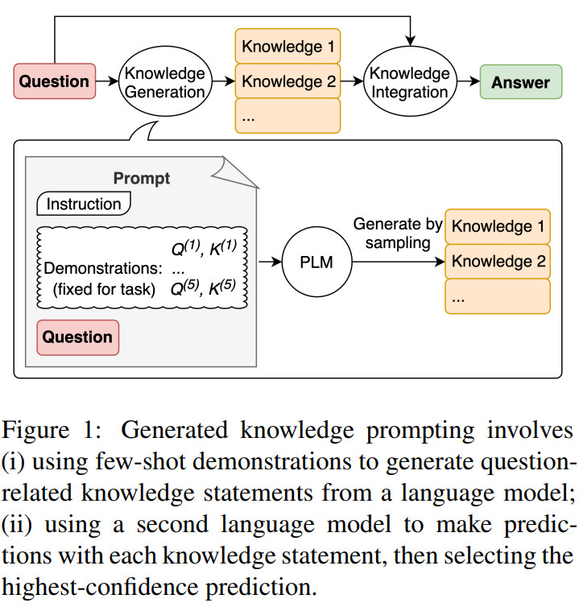{: .align-center}

- Generate a “knowledge” that is related to the original prompt
- Append the knowledge as additional context to the original prompt to generate the final answer

### [Retrieval Augmented Generation (RAG)](https://arxiv.org/pdf/2005.11401.pdf)

- LLMs are trained with a knowledge cutoff, making more recent information unavailable to access
- However, it can perform a zero-shot reasoning considerably well given enough context

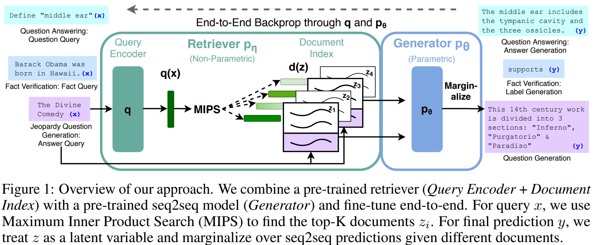{: .align-center}

- The idea is to create vectors from chunks of documents, i.e. the source of information
- For each user prompt, it will be match with the top-K most similar document chunks and combined to give additional context

## Expanding the LLM Generation

LLM models are autoregressive, so they generate one token at a time. During the generation process, they consider past tokens to get the next token.

The idea of expanding the LLM generation works because instead of giving the final answer to the prompt directly as a short answer, it generates more token, giving more context for the next token generation, thus resulting in better answer overall.

### [Chain-of-Thought](https://arxiv.org/pdf/2201.11903.pdf)

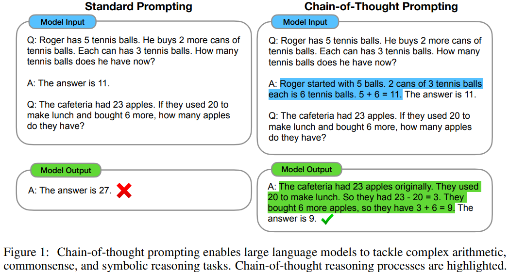{: .align-center}

There are also many variations introduced that were derived from this techniques.

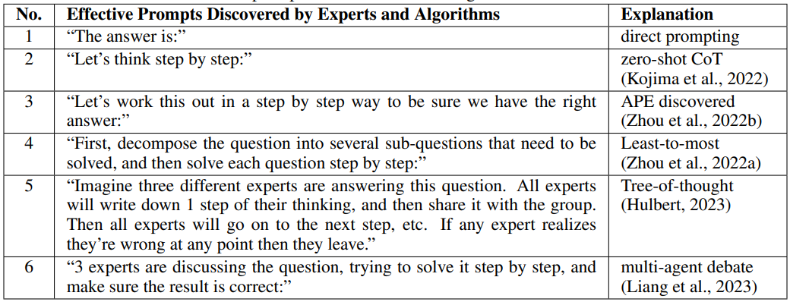{: .align-center}

### [Tree-of-Thought](https://arxiv.org/pdf/2305.10601.pdf)

- Similar with CoT, but it works by generating intermediate answer with intermediate reasoning
- Similar to how DFS or BFS works, it generates a tree of reasoning and pursue the most likely path to get the best answer

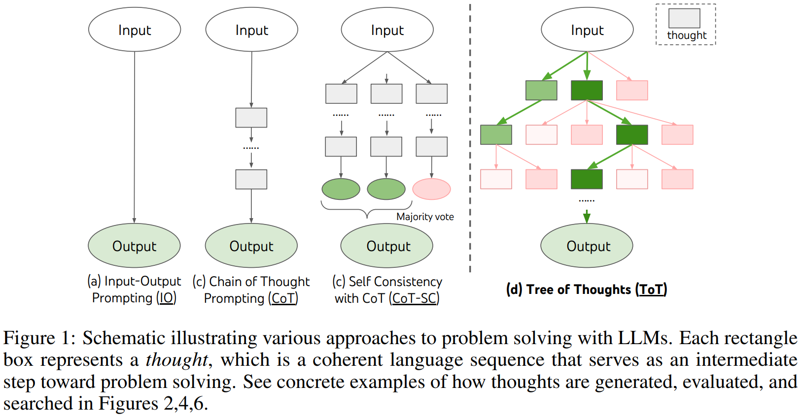{: .align-center}

### [Self-Consistency](https://arxiv.org/pdf/2203.11171.pdf)

It generates the answer for the same prompt multiple times, and select the final answer based on the majority vote (the most consistent).

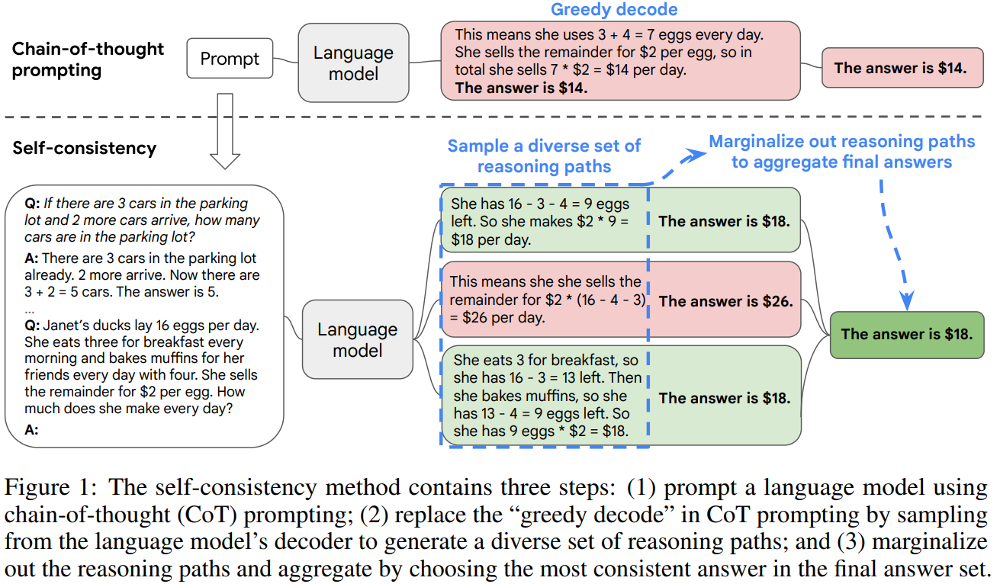{: .align-center}

### [ReAct](https://arxiv.org/pdf/2210.03629.pdf)

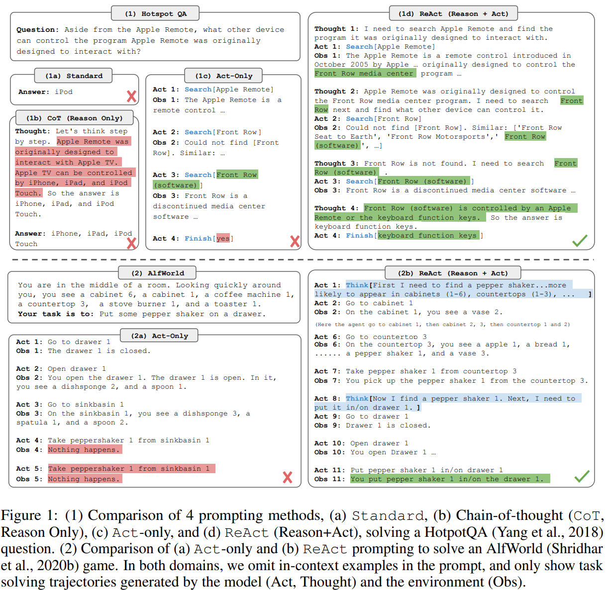{: .align-center}

- Similar with CoT, but it also integrates acting, reasoning, and observation
- It generates the next step based on the reasoning and observation of previous steps
- It enables LLM to interact with external tools that generate the observation
- It also makes the LLM able to adapt each step depending on the observation

### [RCI](https://arxiv.org/pdf/2303.17491.pdf)

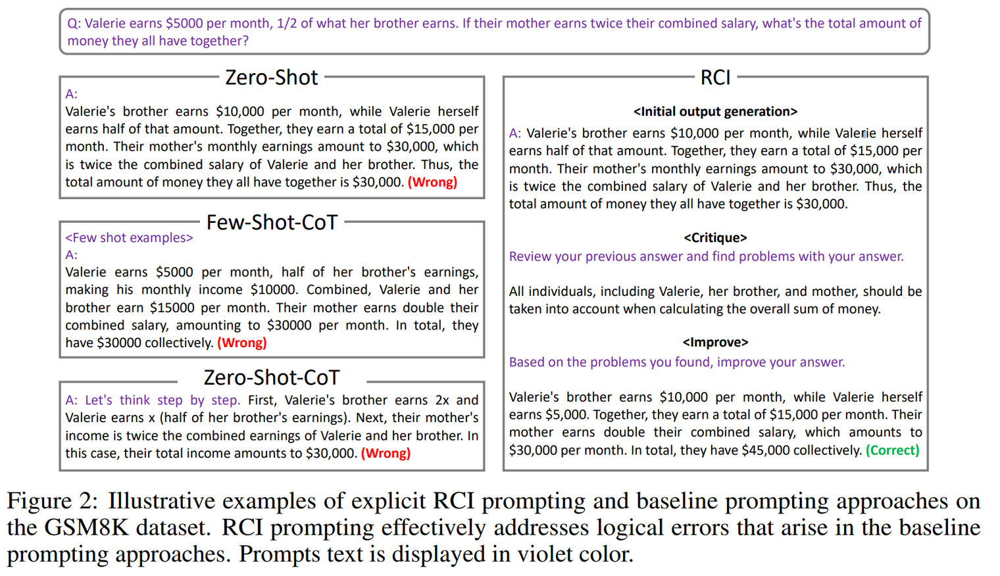{: .align-center}

Introduce “retry” mechanism by finding the problems and improve upon it

### [Reflexion](https://arxiv.org/pdf/2303.11366.pdf)

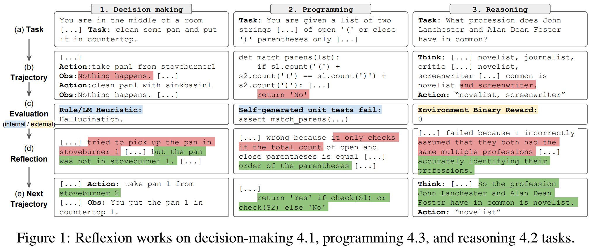{: .align-center}

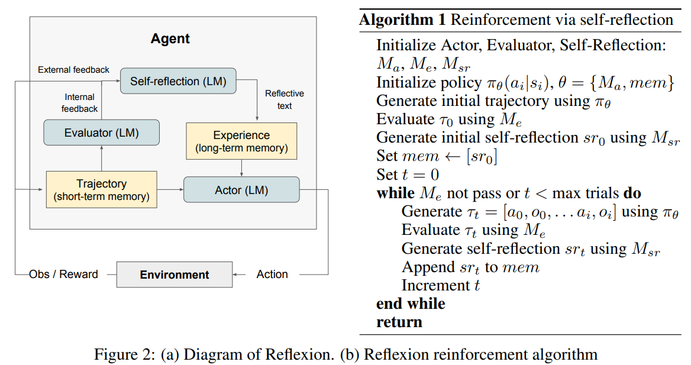{: .align-center}

There are 3 components:
- Actor, the LLM that generates the response conditioned by the prompt and observation
- Evaluator, the one that evaluates the quality of the generation
- Self-reflection, another LLM that generates reinforcement cues to assist the Actor in self-improvement

## Prompt Optimization

Previous techniques tries to develop a **general** algorithm/framework to improve the LLM generation. The following techniques works to develop a prompt that works well on **specific** queries.

### [OIRL](https://arxiv.org/pdf/2309.06553.pdf)

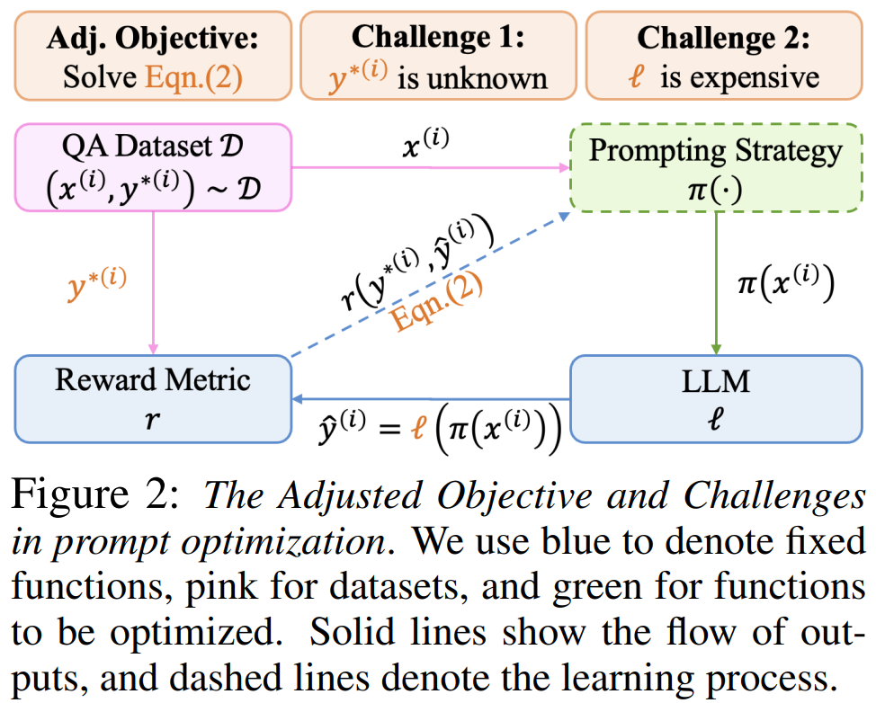{: .align-center}

- It works by creating an offline reward model to score the prompt. However, direct optimization of this reward model requires the parameter of the LLM, which might not always be available. Even if available, it will be very costly as the LLM contains billions of parameters.
- Therefore, a proxy reward model is introduced by training additional model with a supervised learning objective to minimize the discrepancies with the true reward.

### [OPRO](https://arxiv.org/pdf/2309.03409.pdf)

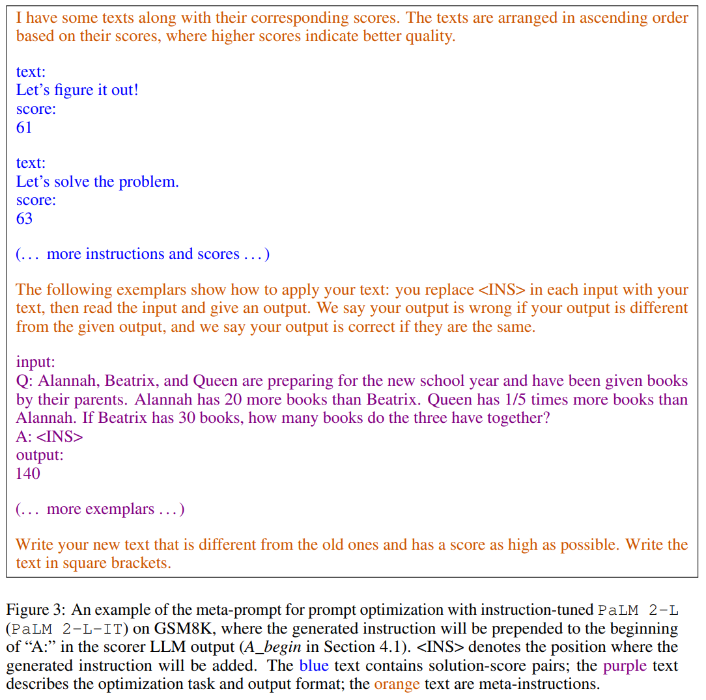{: .align-center}

- This algorithm works by prompting the model to “generate a new instruction that achieves a higher accuracy” given trajectories of past solutions paired with their optimization scores, sorted in **ascending** order
- The model has to pick up the pattern to generate a better solution