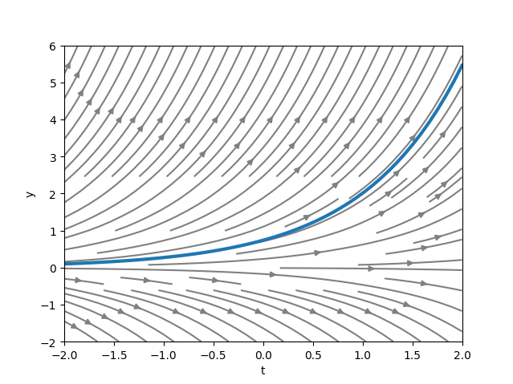
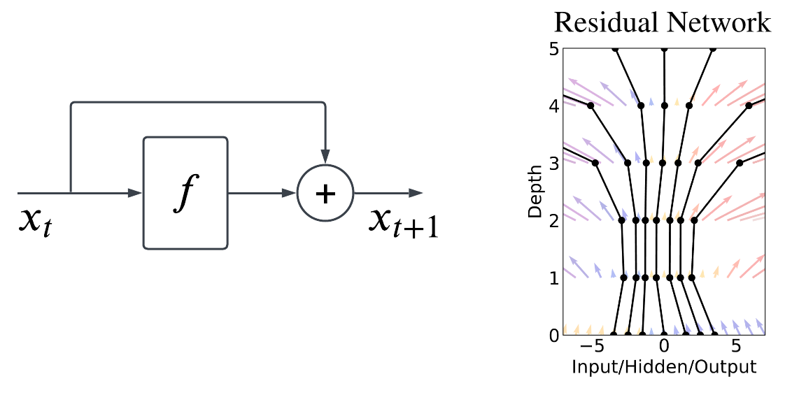
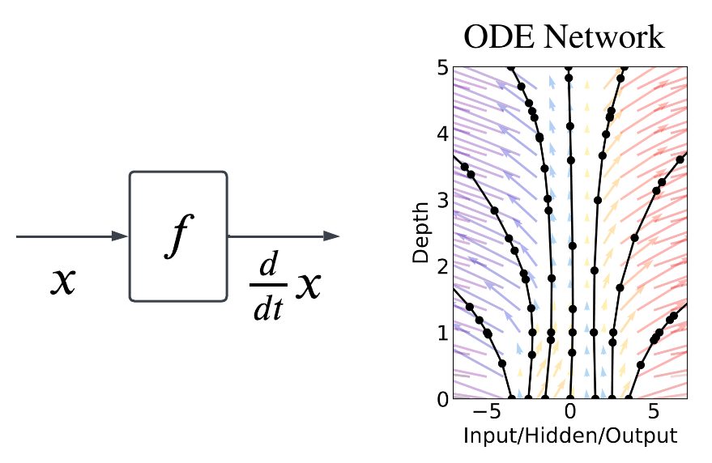
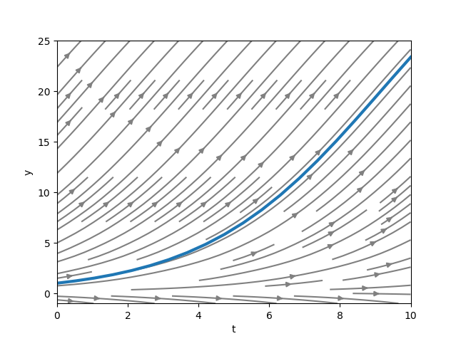
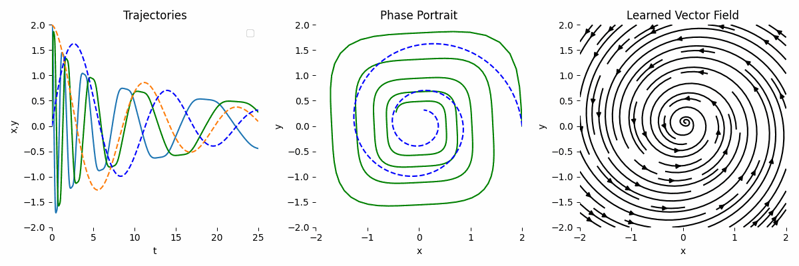
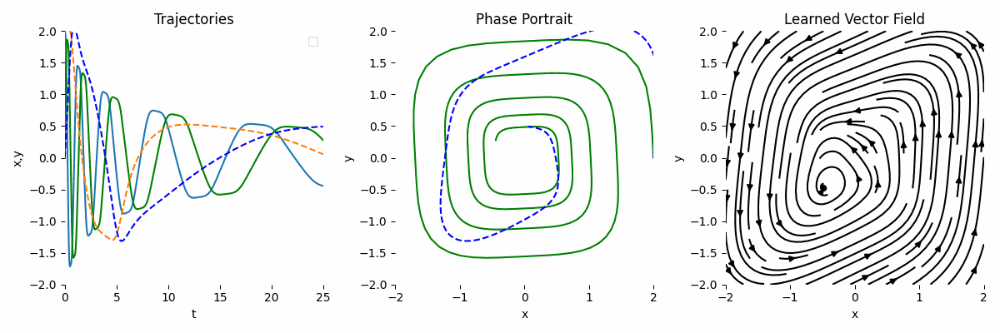
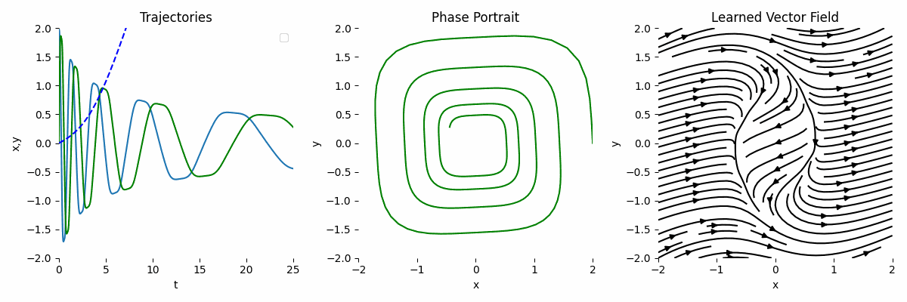
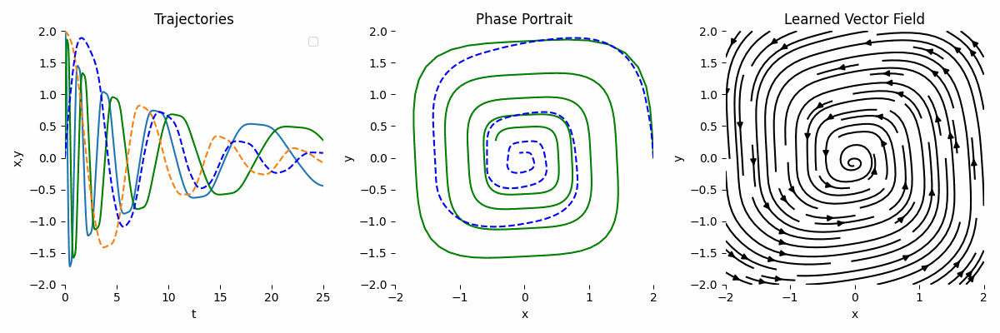

In this post, we are going to explore the intuition on relating Ordinary Differential Equations (ODE) to Neural Ordinary Differential Equations (NODE).

# Ordinary Differential Equation (ODE)
ODE describes an equation that relates a function to its derivatives. The order of an ODE is the highest order of the derivative in the equation. For example, the first-order ODE is:

$$
\begin{equation}
\frac{dy}{dt} = f(t, y)
\end{equation}
$$

Note that in ODE, the dependent variable is a function of a **single independent variable**. Therefore, in the derivative we use $$d$$ symbol as opposed to $$\partial$$ in partial differential equations (PDE).

## Autonomous vs Non-Autonomous ODE
An autonomous ODE is an ODE where the independent variable does not appear in the RHS of the equation. For example, the following ODE is autonomous:

$$
\begin{equation}
\frac{dy}{dt} = y^2
\end{equation}
$$

Conversely, the following ODE is non-autonomous:

$$
\begin{equation}
\frac{dy}{dt} = t + y
\end{equation}
$$

## Initial Value Problem (IVP)
Solution to an ODE is a function that satisfies the equation. IVP is a differential equation which has an additional constraint on how the function behaves at a specific point. For example, the following ODE is an IVP.

$$
\begin{equation}
\frac{dy}{dt} = t + y, \text{ where } y(0) = 1
\end{equation}
$$

The above ODE has general solution $$y(t) = Ce^t - t - 1$$, where $$C$$ is a constant introduced from the integration process. The initial condition $$y(0) = 1$$ is used to determine the value of $$C$$.

In general, we need **as many initial conditions as the order of the ODE** to determine the constants in the general solution.

## Slope Field
Also known as direction field/vector field, slope field visualizes the slope of a line tangent to the solution curve at each point in the domain. The idea is to "feel" how the solution curve would look like. 

To get a vector field, we simply have to evaluate the RHS of the ODE at each point in the domain. For example, consider the following ODE:

$$
\begin{equation}
\frac{dy}{dt} = y, \text{ where } y(-2) = 0.1
\end{equation}
$$

{: .align-center}

The <span style="color: gray;">gray lines</span> in the graph above represent the slope field while the <span style="color: #1f77b4;">blue line</span> represents the solution curve. Notice that the solution curve is tangent to the slope field at each point.

## Solving ODE
We will only explore the analytical solution for first-order ODE.

### Separable Differential Equation
Separable differential equation has the following general form:

$$
\begin{equation}
\frac{dy}{dt} = f(t)g(y)
\end{equation}
$$

To solve this, we simply have to isolate the variables and integrate both sides.

$$
\begin{align}
\frac{1}{g(y)}dy &= f(t)d(t) \\
\int \frac{1}{g(y)}dy &= \int f(t)d(t)
\end{align}
$$

For example, given the following ODE:

$$
\begin{equation}
\frac{dy}{dt} = 3t^2y^2, \text{ where } y(1) = 4
\end{equation}
$$

$$
\begin{align}
\int \frac{1}{y^2}dy &= \int 3t^2d(t) \\
\frac{-1}{y} &= t^3 + C \\
y &= \frac{-1}{t^3 + C}
\end{align}
$$

Substituting the initial condition $$y(1) = 4$$,

$$
\begin{align}
4 &= \frac{-1}{1+C} \\
1 + C &= \frac{-1}{4} \\
C &= \frac{-5}{4}
\end{align}
$$

Therefore, the solution is:

$$
\begin{align}
y &= \frac{-1}{t^3-\frac{5}{4}} \\
y &= \frac{4}{5 - 4t^3}, \text{ where } t \neq \sqrt[3]{\frac{5}{4}}
\end{align}
$$

### Integrating Factor
Another method to solve first-order ODE is by using integrating factor. The general form of first-order ODE is:

$$
\begin{equation}
\frac{dy}{dt} + p(t)y = q(t),
\end{equation}
$$

where p(t) and q(t) are functions of t. The integrating factor is defined as $$e^{\int p(t)dt}$$. To solve the ODE, multiply both sides with the integrating factor and use the product rule of differentiation.

$$
\begin{align}
e^{\int p(t)dt}\frac{dy}{dt} + e^{\int p(t)dt}p(t)y &= e^{\int p(t)dt}q(t) \\
\frac{d}{dt}(e^{\int p(t)dt}y) &= e^{\int p(t)dt}q(t) \\
\int \frac{d}{dt}(e^{\int p(t)dt}y) &= \int e^{\int p(t)dt}q(t) dt \\
e^{\int p(t)dt}y &= \int e^{\int p(t)dt}q(t)dt \\
y &= e^{-\int p(t)dt}(\int e^{\int p(t)dt}q(t)dt + C)
\end{align}
$$

Note that at any time of the equation, if a constant is operated with another constant, it can be combined into a single constant.

# Neural Ordinary Differential Equation (NODE)
First introduced by [Chen et al. (2018)](https://arxiv.org/abs/1806.07366). The idea steams from [Residual Network](https://arxiv.org/pdf/1512.03385) (ResNet). The main idea introduced in ResNet is the **skip connection** which allows the network to learn residual information by simply adding the input and output of the residual block together.

## Relation to Residual Network
{: .align-center}

We can also think the residual block as a function that evolves the input from one timestep to the next timestep, which can also be written as:

$$
\begin{equation}
x_{t+1} = x_t + f(x_t, \theta_t),
\end{equation}
$$

where $$f(:, \theta_t)$$ is the residual block parameterized by $$\theta_t$$. Note that in ResNet, we typically stack multiple residual blocks, hence each block has their own parameters. In other words, the residual block is a function that **learns the difference** between subsequent timesteps.

Note that the above equation is basically euler method to solve ODE given an initial value using vector field $$f$$. Therefore, what the neural network is learning can also be thought of the **vector field**. As it is the most basic numerical method, the solution given by euler method is usually not accurate due to the **fixed and/or large step size**.

## From ResNet to NODE
The original ResNet equation can be interpreted as euler discretization of ODE.

$$
\begin{align}
x_{t+\Delta t} = x_t + \Delta t f(x_t, \theta_t) \\
\frac{x_{t+\Delta t} - x_t}{\Delta t} = f(x_t, \theta_t)
\end{align}
$$

If we make the step size infinitesimally small, i.e., we have ResNet with infinite layers, we basically have,

$$
\begin{align}
\lim_{\Delta t \to 0} \frac{x_{t+1} - x_t}{\Delta t} &= f(x, \theta) \\
\frac{d}{dt}x &= f(x, \theta).
\end{align}
$$

We learn the derivative using a neural network parameterized by $$\theta$$. This is the main idea of ODE. It learns **continuous** vector field. More importantly, if we can learn $$f$$ using a neural network, we can then use a fancier integrator like Runge-Kutta, to get much more accurate solution of $$x_t$$.

{: .align-center}

With NODE, we can have irregularly spaced points (the black points in the figure above) in time, i.e., the observations, to train the network parameters such that when we use the learned vector field to integrate the solution trajectories, they fit with the initial observations.

## Practical Examples
The original NODE authors implemented [`torchdiffeq`](https://github.com/rtqichen/torchdiffeq) library in Python to solve ODE.

### Solving without Neural Network
Let suppose we have the following ODE:

$$
\begin{equation}
\frac{dP}{dt} = 0.4(1-\frac{P}{40})P, \text{ where } P(0) = 1
\end{equation}
$$

We can solve that ODE using the following code:
```python
import numpy as np
import torch
import matplotlib.pyplot as plt
from torchdiffeq import odeint

device = torch.device('cuda' if torch.cuda.is_available() else 'cpu')

# setup initial conditions
P0 = torch.tensor([1.0]).to(device)
t = torch.linspace(0., 10.0, 20).to(device)

class ODE(torch.nn.Module):
    def forward(self, t, y):
        return 0.4 * (1 - (y / 40)) * y # defines the ODE

with torch.no_grad():
    P = odeint(ODE(), P0, t, method='dopri5')

# visualization
p_coords, t_coords = np.mgrid[-1:25:11j, 0:10:11j]
dydt = ODE()(torch.Tensor(t_coords).flatten(), torch.Tensor(p_coords).flatten()).cpu().detach().numpy()
V = dydt
U = np.ones_like(dydt)
mag = np.sqrt(U**2 + V**2)
U /=  mag
V /=  mag
U = U.reshape(11, 11)
V = V.reshape(11, 11)

plt.streamplot(t_coords, p_coords, U, V, color='grey')
plt.plot(t.cpu().numpy(), P.cpu().numpy(), linewidth=3)
plt.xlabel('t')
plt.ylabel('y')
plt.show()
```

If we run the code, we will get the following figure.

{: .align-center}

### Solving with Neural Network
The previous example works because we already know the exact equation of the ODE which is not always the case. Therefore, we can substitute the RHS with a neural network altogether.

We will follow the example given by [`ode_demo.py`](https://github.com/rtqichen/torchdiffeq/blob/master/examples/ode_demo.py). The actual ODE is given by:

$$
\begin{equation}
\frac{dy}{dt} = y^3 \begin{bmatrix}-0.1 & 2.0\\ -2.0 & -0.1 \end{bmatrix}, \text{ where } y(0) = [ 2.0, 0.0 ]
\end{equation}
$$

#### Pure Observation
Let's assume that we only have observation data, i.e., the initial conditions. Therefore, we can model the ODE like this:

$$
\begin{equation}
\frac{dy}{dt} = y A,
\end{equation}
$$

where A is a learnable parameters in the form of MLP. In the code, we can change the `ODEFunc` class to:
```python
class ODEFunc(nn.Module):

    def __init__(self):
        super(ODEFunc, self).__init__()

        self.net = nn.Sequential(
            nn.Linear(2, 500),
            nn.ReLU(),
            nn.Linear(500, 2),
        )

        for m in self.net.modules():
            if isinstance(m, nn.Linear):
                nn.init.normal_(m.weight, mean=0, std=0.1)
                nn.init.constant_(m.bias, val=0)

    def forward(self, t, y):
        return self.net(y)
```

{: .align-center}

As we can see, the result is not very accurate compared to the ground truth.

#### Observation + Known Transformation
If we have observation and we know the underlying transformation, we can model the ODE like this:

$$
\begin{equation}
\frac{dy}{dt} = y^3 A,
\end{equation}
$$

Then, the `forward` function can look like this:
```python
    def forward(self, t, y):
        return self.net(y**3)
```

{: .align-center}

By combining the observation and the known transformation, the result is much more accurate. This is the **main strength** of NODE.

#### Failure Case of Wrong Transformation
If we use a completely wrong transformation, then the result will be completely off. Let's say we model the ODE as:

$$
\begin{equation}
\frac{dy}{dt} = y^2 A,
\end{equation}
$$

Then, the `forward` function can look like this:
```python
    def forward(self, t, y):
        return self.net(y**2)
```

{: .align-center}

#### Big Network
As neural network is a universal function approximator, the hope is as we scale the network, the result will be more accurate. Let's assume we only use observations and we use a bigger network like this:
```python
class ODEFunc(nn.Module):
    def __init__(self):
        super(ODEFunc, self).__init__()

        self.net = nn.Sequential(
            nn.Linear(2, 500),
            nn.ReLU(),
            nn.Linear(500, 500),
            nn.ReLU(),
            nn.Linear(500, 500),
            nn.ReLU(),
            nn.Linear(500, 2),
        )

        for m in self.net.modules():
            if isinstance(m, nn.Linear):
                nn.init.normal_(m.weight, mean=0, std=0.1)
                nn.init.constant_(m.bias, val=0)

    def forward(self, t, y):
        return self.net(y)
```

{: .align-center}