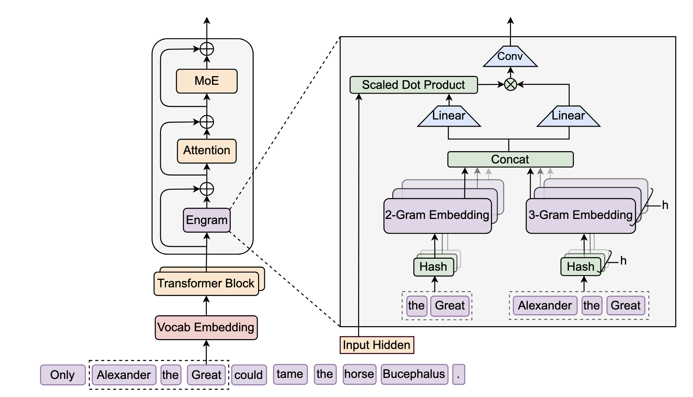
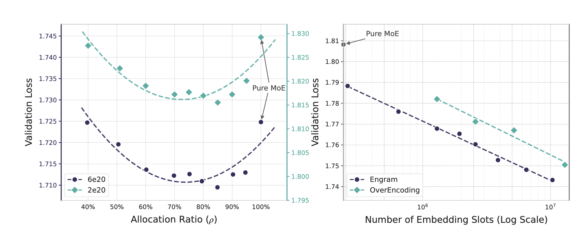
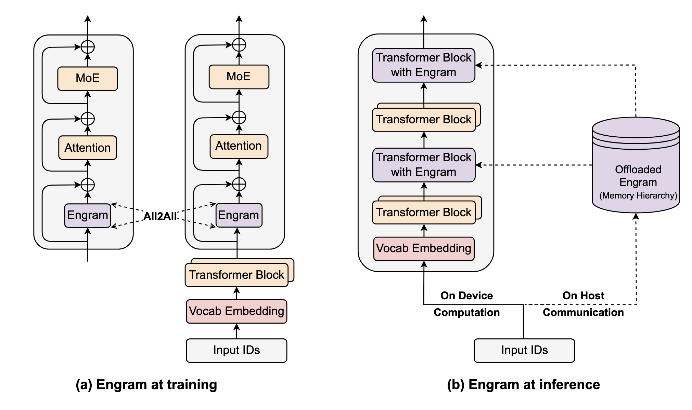

In this post, we will do a deepdive into Engram, which is a novel memory module introduced by Deepseek. The content is based on the [original paper](https://arxiv.org/pdf/2601.07372) and the [official implementation](https://github.com/deepseek-ai/Engram).

**Note**: To gain better understanding on how it is implemented, I highly recommend checking the official implementation [here](https://github.com/deepseek-ai/Engram/blob/main/engram_demo_v1.py). It is self-contained and very readable and easy to understand.
{: .notice--info}

## Background
The primary reason on developing Engram is to improve LLM performance. It makes sense that LLM with bigger parameters will always have better performance. However, we need to be smart on how we scale this parameters because more parameters also means more compute resource needed to run it.
To that end, **sparsity** is one of the most prominent design these day to trade-off between compute and performance. One of the primary realization is Mixture-of-Experts (MoE) where each token is routed into just several experts, in contrast to dense model.

Looking at the linguistic signals, researchers argue that there is one more axis of sparsity to optimize, which is memory. Language modelling has two primary sub-tasks:
1. **Reasoning**, where the model needs to understand the semantic content and provide the relevant response
2. **Knowledge retrieval**, where the model simply need to retrieve information about named entities and formulaic patterns

Transformer inherently treats all tokens equally, requiring the same amount of compute for each token. However, focusing on knowledge retrieval, this should not be the case, because we are wasting compute to **simulate** information retrieval on something that is static.

## Core Idea
As human, when we heard some known entities, e.g., Linux, we don't reason to understand what that is. We automatically retrieve stored information about that from our brain and immediately know what it is. This is the idea behind Engram. We want this native lookup ability to enhance transformer performance. For static information, we can leverage a big lookup table where we can retrieve information very efficiently. The trade-off is that we need memory to store all static information.

## Engram
As the name suggests, Engram is inspired from $$n$$-gram models, e.g. bi-gram, tri-gram. Engram is basically a massive lookup table for n-gram and intelligently combining the information retrieved back to the transformer layer. To understand how it works, let's first define these notations:
- $$X = (x_1, ..., x_T)$$, an input sequence $$X$$ with $$T$$ tokens.
- $$\mathbf{H}^{(l)} \in \mathbb{R}^{T\times d}$$, hidden states of the sequence at layer $$l$$ of the tranformers, each has dimension $$d$$.

{: .align-center}

Given a token at $$t$$, we form suffix $$n$$-gram, i.e., combining tokens from $$t-n+1$$ to $$t$$, and perform sparse retrieval of the stored information via lookup table. The result is then combined back together to the hidden states via gating mechanism.

### Sparse Retrieval
#### Token Compression
Standard tokenizers will split words while prioritizing **lossless reconstruction**, that is to say if we have words like "apple" and "Apple", they will be mapped into different index. so that it can be transformed back into the exact word, maintaining the capital case. However, we don't really need this for our case of memorizing static information because "apple" and "Apple" is semantically equivalent.

To maximize the semantic density, given a tokenizer, we remapped the raw token index into a canonical index by performing normalization steps on the original index. The key takeaway is that the new tokenizer will map all similar tokens (case-insensitive, whitespace removal, special character handling) into the same index to compress the vocab size. 

For a token at $$t$$, we do the following:
1. Map the raw token $$x_t$$ to canonical token $$x'_t$$.
2. Form suffix $$n$$-gram $$g_{t,n} = (x'_{t-n+1}, ..., x'_t)$$.

#### Multi-Head Hashing
Now the problem is given an $$n$$-gram, how do we use it to key the lookup table. Directly using it as it is **will not be feasible** because that means we need to store every single possible combination of $$n$$-gram, which leads to memory explosion.

To alleviate this, Engram uses hashing to convert the $$n$$-gram into a key. To minimize the chance of hash collision, there are $$K$$ distinct hash head for each $$n$$-gram order, i.e., bi-gram and tri-gram will have different hash heads. So, the lookup table is basically **different** for each head $$k$$ for each gram order $$n$$, we'll refer to this as $$\mathbf{E}_{n,k}$$.

To convert the $$n$$-gram at the $$t$$-th token, we utilize a deterministic function $$\phi_{n,k}$$,

$$
z_{t,n,k} = \phi_{n,k}(g_{t,n}),
$$

where $$z_{t,n,k}$$ is they key corresponds to the $$k$$-th head. We will then use this to key the lookup table:

$$
\mathbf{e}_{t,n,k} = \mathbf{E}_{n,k}[z_{t,n,k}],
$$

where $$\mathbf{e}_{t,n,k}$$ is the stored feature/embedding on the $$k$$-th lookup table. Finally, the stored memory $$\mathbf{e}_t$$ for the $$n$$-gram at $$t$$ is simply the contatenation of all the stored memory in all heads:

$$
\mathbf{e}_t = \big\Vert_{n=1}^{N} \big\Vert_{k=1}^{K} \, \mathbf{e}_{t,n,k}.
$$

### Context-aware Gating
The stored memory, because it is static, it means that there can be ambiguity, whether it comes from semantic meaning or noise from hash collision. For example, the word "bark" can mean outer layer of a tree trunk, or the sound made by a dog.

To resolve this, before combining this information back to the hidden states, Engram uses gating mechanism, which is very similar with attention mechanism.
Basically, the hidden state $$h_t$$ contains global context of token $$t$$, so it can be used as the "query", while the stored memory $$\mathbf{e}_t$$, will serve as the "key" $$\mathbf{k}_t$$ and "value" $$\mathbf{v}_t$$.

It can be calculated as:

$$
\mathbf{k}_t  = \mathbf{W}_k \mathbf{e}_t, \quad \mathbf{v}_t  = \mathbf{W}_v \mathbf{e}_t,
$$

where $$\mathbf{W}_k$$ and $$\mathbf{W}_v$$ are learnable projection matrices. Then, we can calculate the scalar gate $$\alpha_t \in (0, 1)$$ as:

$$
\alpha_t = \sigma\left(\frac{\mathrm{RMSNorm}(\mathbf{h}_t)^\top \mathrm{RMSNorm}(\mathbf{k}_t)}{\sqrt{d}}\right).
$$

$$\sigma$$ is sigmoid function, $$\mathrm{RMSNorm}$$ is used to ensure gradient stability. The idea is that when the stored memory $$\mathbf{e}_t$$ has nothing to do with the current context $$h_t$$, it will push $$\alpha_t$$ towards 0, vice versa.

The gated output is simply defined as $$\tilde{\mathbf{v}_t} = \alpha_t \cdot \mathbf{v}_t$$.

Finally, to combine the gated output result back to the original hidden states, we utilize 1D convolution layer with SiLU activation to expand the receptive field and enhance the non-linearity. Specifically, for a sequence of gated output $$\tilde{\mathbf{V}} \in \mathbb{R}^{T\times d}$$, the final output $$\mathbf{Y}$$ is given as:

$$
\mathbf{Y} = \mathrm{SiLU}(\mathrm{Conv1D}(\mathrm{RMSNorm}(\tilde{\mathbf{V}}))) + \tilde{\mathbf{V}},
$$

This output is then combined back again to the original hidden states using residual connection: 

$$
\mathbf{H}^{(l)} = \mathbf{H}^{(l)} + \mathbf{Y}
$$

## Impact

The first time I read this paper, while I undertood the idea, after reading the algorithm, I was wondering won't this simply add more calculation from the Engram module, instead of making the whole model lighter. While this is true, on practice, we don't exactly add this Engram module on every transformer layers.

The researchers conducted experiments to see, given the same amount of compute resource (number of parameters and FLOPs), how to best split the allocation between experts weights and the Engram module. When allocating all the weights for Engram module, the model essentially loses the reasoning capability. On the other hand, allocating all weights for MoE introduce the **simulated retrieval** problem that we discussed earlier.

They discover a U-shaped scaling law. The optimum allocation for lowest validation lost happens when 75-80% of the weights are reserved for the MoE, while the rest is used for the Engram module. In the original paper, they also included results where adding the Engram module not only improve performance on knowledge retrieval task, but also general reasoning as well as math and coding.

{: .align-center}

What I'm most excited about however, is the fact that with this kind of architecture, we can simply store the Engram module weights on RAM instead of VRAM, making it easier to run on **consumer-grade** hardware. This is because the Engram module is essentially a big lookup table and we don't do any heavy computation to retrieve the stored memory.

## Something to Keep in Mind
While the idea sounds promising, the experiments were conducted on smaller scale LLM, like 4B dense and 27B MoE. Much larger scale LLM may introduce different scaling law or require additional tweaking to make this Engram module behave as expected.

There are many ablations study that I do not cover in this post, like where to put the Engram module in the transformer layers, how sensitive is the impact of the Engram module placement, and so on.